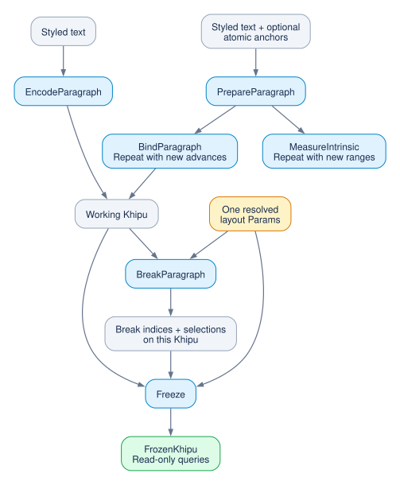

# Khipu: from Text to Typesetting

## Metaphor

> “Khipu were recording devices fashioned
> from strings historically used by a number of cultures in the region of
> Andean South America.
> Khipu is the word for »knot« in Cusco Quechua.
> A khipu usually consisted of cotton or camelid fiber strings. The Inca
> people used them for collecting data and keeping records, monitoring tax
> obligations, properly collecting census records, calendrical information,
> and for military organization. The cords stored numeric and other values
> encoded as knots, often in a base ten positional system. A khipu could
> have only a few or thousands of cords.”
> ––Excerpt from a Wikipedia article about khipus

The Khipukamayuq (Quechua for “knot-makers”) were the scribes of those
times, tasked with encoding tax figures and other administrative
information in knots.
We will use this analogy to call typesetting items “khipus” or “knots,”
and objects which produce khipus will be “Khipukamayuq”s (I admit this is a tough one).
Knots implement items for typesetting paragraphs.

## Create Khipus from Text

A Khipukamayuq is part of a typsetting pipeline and will transform text into khipus.
Khipus are the input for linebreakers. The overall process of creating
them and the interaction with line breaking is fairly complicated, especially if
one considers international scripts.

We will use a box-and-glue model and the various knot types more or less
implement the corresponding node types from the TeX typesetting system.
The diagram below depicts an approximation of the overall task flow for typesetting
a single paragraph.

Khipu shapes styled text once, chooses line endings with first-fit or
Knuth–Plass, and freezes a chosen trial into final widths and visual knot order.
Its reusable paragraph is an immutable SoA `Khipu`; atomic advances belong to
`AtomicBinding`, and each trial's decisions belong to an immutable `Tikray`.
Rendering, CSS, frame selection and vertical assembly belong to clients.

`Config{}` uses deterministic synthetic shaping without font files. Supply a
complete `Config.Streaming` for real fonts and application styles. Font loading,
coverage and fallback are caller responsibilities. All typesetting APIs are
synchronous, with no context argument. Contexts remain inside streaming shaping
and font loading; stream failures still cancel and join producers before cleanup.

<a id="encode-and-break-a-paragraph"></a>

## Prepare, break and freeze

```go
package main

import (
    "fmt"
    "github.com/npillmayer/cords/styled"
    "github.com/npillmayer/khipu"
    "github.com/npillmayer/khipu/dimen"
    "github.com/npillmayer/khipu/linebreak"
    "github.com/npillmayer/khipu/linebreak/firstfit"
    "github.com/npillmayer/uax/bidi"
)

func main() {
    text := styled.TextFromString("Hello world")
    para, err := styled.ParagraphFromText(&text, 0, text.Raw().Len(), bidi.LeftToRight, nil)
    if err != nil { panic(err) }
    q := khipu.NewKhipukamayuq(khipu.Config{})
    material, discovery, err := q.EncodeParagraph(para)
    if err != nil { panic(err) }
    binding, err := khipu.BindParagraph(material, nil)
    if err != nil { panic(err) }
    geometry := firstfit.DefaultLayout(linebreak.RectangularParShape(100 * dimen.PT))
    plan, err := firstfit.BreakParagraph(khipu.BreakRequest{
        Binding: binding, Discovery: discovery,
        Geometry: khipu.GeometryRequest{
            Shape: geometry.LineShape,
            LeftSkip: geometry.LeftSkip, RightSkip: geometry.RightSkip,
        },
    }, nil)
    if err != nil { panic(err) }
    frozen, err := khipu.Freeze(plan)
    if err != nil { panic(err) }
    fmt.Println("lines:", frozen.LineCount())
}
```

This prints `lines: 1`. [Executable examples](example_test.go) also cover KP,
hyphenation, intrinsic measurement and inline objects. A later trial can use a
new width, new binding or different breaker without changing `plan`. Freeze
uses its captured widths/skips and selected replacements, never a shape callback.

<a id="public-lifecycle"></a>



[DOT source](doc/diagrams/public-lifecycle.dot).

## Main entry points

| Need | API |
| --- | --- |
| Styled text with optional U+FFFC atomic anchors | `q.PrepareParagraph(input, options)` → `(*Khipu, *Discovery, error)` |
| Text-only convenience | `q.EncodeParagraph(para)`; configured hyphenation enables automatic plus explicit opportunities |
| Inspect material | `KnotCount`, `Knot`, `AtomicIDs`, `ID`; values/slices are detached |
| Supply signed atomic advances | `BindParagraph(material, advances)` → `*AtomicBinding` |
| Intrinsic widths | `MeasureIntrinsic(material, discovery, request)` |
| Break a fresh paragraph | `firstfit.BreakParagraph(request, params)` or `knuthplass.BreakParagraph(request, params)` |
| Inspect one trial | `Tikray.Lines`, `Policies`, `PolicyForLine`, `Diagnostics`, `BreakpointPositions` |
| Accept a prefix | `Checkpoint(plan, acceptedLines)` → `*BreakCheckpoint` |
| Continue at another width | `firstfit.ContinueParagraph(requestWithPrefix, params)` |
| Final horizontal result | `Freeze(plan)` → `*FrozenKhipu` |

<a id="fixed-size-atomic-inline-items"></a>

An unbound atomic template has `MetricsKnown == false`; a bound zero advance is
valid. Bind exactly one finite signed advance per occurrence ID, in any order.
Bindings share base storage and never shape or discover. Keep object payloads,
vertical dimensions and matching nested output in the application.

Preparation fixes hyphenation mode. `Discovery` memoizes complete immutable
replacement pairs (including empty results); failures are retryable. First-fit
and KP select alternatives independently. Measurement supports `NoHyphenation`
and bounded `ExplicitHyphenation`; automatic intrinsic hyphenation and general
multiple-position/variant measurement remain unsupported. See the
[preparation guide](doc/PREPARED_PARAGRAPHS.md).

<a id="integration-and-ownership"></a>

## Ownership and continuation

`IncarnationID` is a process-local token, not a hash, pointer to the constructor
or replay identity. It changes with each new preparation. Requests require a
matching binding/discovery pair even when hyphenation is disabled. Keep borrowed
source, styles and font services stable. Configuration and owned slices are
copied; arbitrary services are not cloned. Discovery serializes misses, while
collaborators shared across different facilities retain their own concurrency
requirements. Search state is private to each call.

A checkpoint retains copied accepted decisions, geometry and policy. It rejects
foreign incarnations and changes to atomic advances consumed by the prefix;
suffix-only advances may change. Continuation is initially first-fit with
`NoHyphenation`, including a prefix originally selected by KP. The prefix is
neither searched nor sent to the width callback. Full freezing remains allowed.
Frame heights, page optimization and vertical/interior compatibility are client
responsibilities. See [continuation](doc/PREPARED_PARAGRAPHS.md#checkpoint-continuation).

Process paragraphs in turn. Release material, discovery, trial plans and
checkpoints once each paragraph has fully flowed or is abandoned. Frozen results
retain their stable source/glyph data without retaining those working handles.
No backend, Khipu, Tikray or checkpoint serialization is introduced here.

<a id="package-structure"></a>

## Services and package map

| Package | Responsibility |
| --- | --- |
| `khipu` | Immutable material, binding, discovery, Tikray publication, checkpoints, intrinsic measurement and freezing |
| [contracts](contracts/ReadMe.md) | Backend-independent fonts, styles and streaming shaping |
| [helpers](helpers/ReadMe.md) | Deterministic synthetic services for examples and tests |
| [dimen](dimen/ReadMe.md) | Fixed-point units and dimensions |
| [linebreak](linebreak/ReadMe.md) | Shapes and width summaries |
| [firstfit](linebreak/firstfit/ReadMe.md) | Greedy search and fixed-prefix continuation |
| [knuthplass](linebreak/knuthplass/ReadMe.md) | Multi-pass paragraph cost search |
| [debug](debug/ReadMe.md) | Frozen-width SVG diagrams |
| [khipu-cli](khipu-cli/README.md) | Synthetic command-line layout proofs |

Real backends supply fresh streaming shapers, a resolver and explicit font/size
defaults. Original scalar feature domains and paragraph-wide bidi context are
retained; attached atomics bypass font queries. `CheckFace` runs on each actual
base/replacement stream before shaping. OpenType compatibility checks remain in
the typography adapter, never forwarded to `opentype/otshape`. Failures publish no
partial material or replacement pair and join producers before cleanup.

## Development and migration status

Go 1.25.6; `go.mod` currently replaces `cords` and `uax` with sibling checkouts.
Run `go test ./...`, `go test -race ./...`, `go build ./...` and `go vet ./...`.
The [testing guide](doc/TESTING.md) describes dependency release checks.

PR 1 of [the reflow plan](../typography/doc/REFLOW_PLAN.md) implements the khipu
contract. `PreparedParagraph`, public mutable planes/selection maps and owner
binding/freezing/checkpoint APIs are removed. Typography and tytui adoption is
PR 2/3 and may temporarily fail to compile. Existing production flow measurements
predate this API migration; they are historical evidence, not measurements of
these new accessors/workspaces. No upstream bidi fix is included.

See the [documentation index](doc/README.md) and
[historical background](doc/history/BACKGROUND.md).
