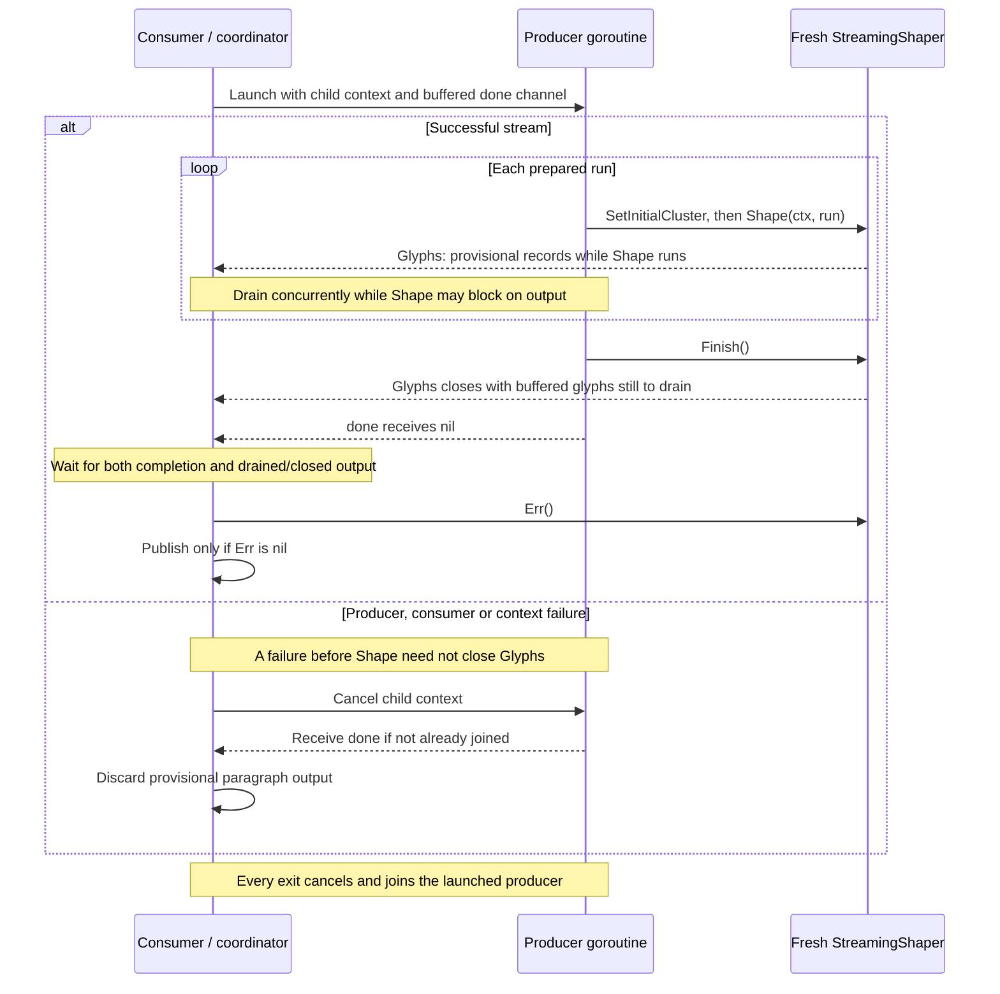
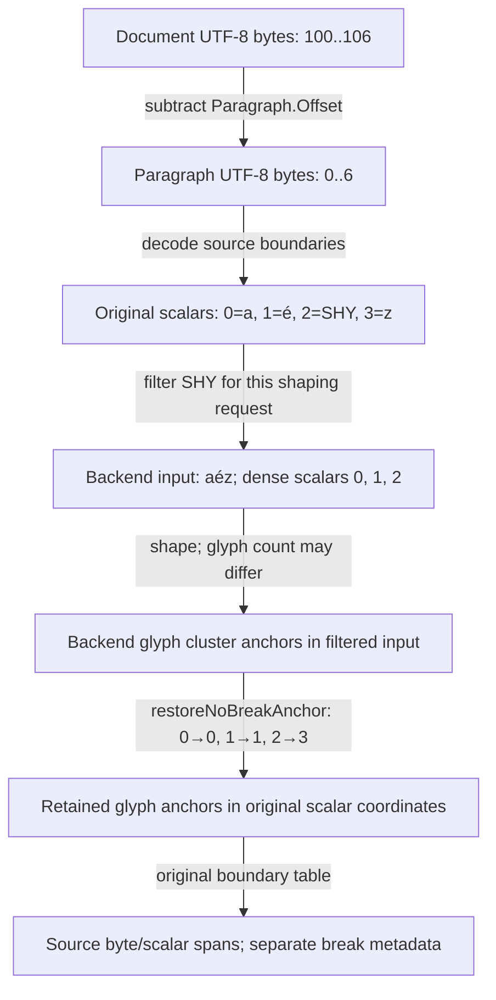

# contracts

Streaming shaping and style resolution are integrated into paragraph encoding
and discretionary reshaping. The metric-only `Shaper` has been removed;
`RuneReader` remains the streaming input contract. See
[the integration guide](../README.md#integration-and-ownership).

`github.com/npillmayer/khipu/contracts` defines the font, shaping, and style
services used by khipu. Implement an adapter against this package when providing
a font backend or application-specific style resolution.

```go
import "github.com/npillmayer/khipu/contracts"
```

The package contains interfaces, their parameter and result types, constants,
and shared argument/unsupported-face error sentinels. Concrete defaults are in
[`helpers`](../helpers/ReadMe.md).

## Scope and Integration Status

| Service | Associated types | Current use |
| --- | --- | --- |
| `FontLoader`, `FontFace`, `FontScale` | `FontMetrics` | Font metrics/scaling used by encoding; loading remains the adapter's responsibility |
| `FontAcceptor` | `CheckFace(FontFace) error` | Read-only instance compatibility, embedded in `StreamingShaper` and typography coverage |
| `StyleResolver` | `ResolvedRunStyle`, `SpacingMode` | Active run resolution; a default implementation is available in `helpers` |
| `StreamingShaper` | `ShapeParams`, `ShapeFeature`, `ShapeBufferOptions`, `ShapeFlushBoundary`, `ShapedGlyph` | Active shaping boundary; a synthetic implementation is available in `helpers` |

The font, resolver, and streaming APIs are used by `EncodeParagraph(ctx, para)`
through `Config.Streaming`, with synthetic defaults for `Config{}`.
Paragraph-specific `Hyphenator` remains in the root package. Paragraph shapes
and discretionary-provider interfaces remain with their linebreaker consumers.

## Atomic Occurrences

`AtomicID` and `AtomicAnchor` describe opaque inline occurrences, independently
of the font services above. IDs are nonzero and paragraph-local. Each anchor
selects the first paragraph-relative UTF-8 byte of a U+FFFC marker; anchors must
be strictly ordered. Unattached markers remain ordinary text. Payloads and
vertical geometry stay with the caller, while the root engine's `BindParagraph`
accepts fixed signed advances. See [prepared paragraphs](../doc/PREPARED_PARAGRAPHS.md#anchors-and-atomic-boundaries)
and the [executable preparation example](../example_test.go).

## Fonts and Style Resolution

[`FontLoader`](font_api.go) loads a face from an `io.Reader`; the adapter retains
the backend data and any required backing storage. Font discovery, family
matching, and fallback selection are outside this interface.

`FontFace` provides immutable metrics and creates a scale for a positive em size.
`FontMetrics` uses signed, unscaled font units. `FontScale.ToDU` converts to
fractional DU without changing signs or axis orientation. Accumulate fractions
before rounding; the caller checks range before converting to `dimen.DU`.
Scales must be immutable and safe for concurrent reads. Shaping adapters must
reject faces from backends they do not support.

[`StyleResolver`](style_resolver.go) returns a complete `ResolvedRunStyle`, not a
property delta. Nil style means no overrides of the supplied defaults. Successful
results require a non-nil font and positive em size. Fixed spacing and an empty
feature list are valid explicit settings.

Resolvers must not mutate style or defaults, and returned feature storage must
remain stable. Supply inherited defaults independently for each run. Font scaling
follows resolution; bidi analysis, script-based run subdivision, and font
fallback are separate responsibilities. `SpacingElastic` describes a policy,
not numerical stretch/shrink capacities.

Features in `ResolvedRunStyle` and its supplied defaults refer to original
scalar positions within the originating style span, including omitted bidi
controls. Preparation resolves each contributing span once, clips features to
each bidi intersection, and rebases them for `ShapeParams`. Nonpositive bounds
mean beginning/end; empty overlaps are omitted and positive reversed ranges
are errors. Explicit bounds beyond the span are clipped. The encoder performs
this preparation before starting its shaping producer.

## Face compatibility

`FontAcceptor.CheckFace` is a mandatory, cheap, concurrent-safe capability check.
It rejects nil/typed-nil or uninitialized instances with `ErrIllegalArguments`
and unsupported representations with `ErrUnsupportedFontFace`. A consumer may
support several representations. It must use the same acceptance rules at its
actual operation boundary, keeping all concrete conversion inside its adapter.
Acceptance is runtime validation, not compile-time pairing or a promise of
coverage, shaping-feature support or renderer compatibility.

Checks perform no I/O, parsing, metric/glyph queries or shaping and do not change
stream state, including terminal errors and cluster bases. Capabilities and
prepared faces remain stable for their service lifetimes. A bridge must preserve
the font instance/glyph identity and emit the units expected by `FontScale`.
Expensive bridge preparation belongs before selection, not inside the check.

Khipu checks every resolved run against the actual stream after run preparation
and before launching any producer. Each fresh lazy pre/post replacement stream
is checked again. Atomics create no text face to check. Successful cached
replacements are reused without shaping; failures publish no partial pair and
remain retryable. Font scaling still occurs during run preparation.

## Streaming Shaping

[`StreamingShaper`](shaping_stream.go) accepts uniform runs and publishes glyph
records on one output channel. `Shape` is synchronous and may block until the
consumer drains output. Run the producer and consumer concurrently.

| Operation or outcome | Contract |
| --- | --- |
| Successful `Shape` | Leaves output open for subsequent runs |
| `Finish` | Idempotently closes idle output and releases stream resources, including unused streams; no drainer needed for unused streams |
| Accepted shaping failure or cancellation | Closes output with terminal `Err`; previously emitted glyphs remain drainable |
| `Finish` or `SetInitialCluster` during `Shape` | Reports an error without disrupting the active call |
| Consumer stops draining | Consumer cancels the producer context; an executing source read need not be interrupted |

Concurrent `Shape` calls are unsupported. `Glyphs` and `Err` may be queried
concurrently. A finished instance cannot be reused for later discretionary
shaping. Commit accumulated paragraph output only after success.

`ShapedGlyph` records use logical shaping order, including RTL runs. Glyph IDs
are meaningful only with their run's face. Advances and offsets are signed font
units, converted using the run's `FontScale`. Advances move the pen; offsets move
the glyph relative to that pen. The channel has no run/cluster completion markers.

### Stream Completion And Failure

The engine's [coordinator](../stream_shaper.go) keeps producer completion separate
from glyph-channel closure. The sequence below summarizes the two outcomes after
a producer has been launched; it does not require a particular channel-observation
order. Shape calls and glyph consumption run concurrently.



The base/replacement stream owner finishes every abandoned idle stream, including
preflight/preparation failures before producer launch. After launch, cleanup
happens only after cancel/join. Cleanup preserves the primary error and independent
resource-release failures. It does not re-add terminal shaping errors already
handled by the coordinator, such as cancellation used to stop the producer after
a consumer failure. Wrapped/joined release errors remain visible through
`errors.Is`. CheckFace itself does not terminate a stream; direct callers can
check a rejected face and then use a supported one.

A completed producer is not proof that all buffered glyphs have been consumed.
Conversely, closed output is not proof of successful production. On failure,
joining waits for the producer to return; cancellation cannot interrupt every
backend source read. A failed or finished shaper is never reused.

## Coordinates and Units

| Value | Coordinate or unit |
| --- | --- |
| `ShapedGlyph.Cluster` | Continuing original Unicode scalar ID, with an optional initial-base override |
| Streaming advances and offsets | Signed font units |
| `ShapeFeature.Start` / `End` | Half-open run-relative original scalar range; nonpositive start/end mean beginning/end |
| Buffer sizes and watermarks | Input scalar counts, independent of output channel capacity |

For `aéz`, one-scalar clusters have byte anchors `0, 1, 3`, but scalar anchors
`0, 1, 2` with initial base zero. Streaming bases continue by input scalar count,
including scalars producing no output. Cluster boundaries alone do not authorize
line breaks; source spans and penalties remain layout metadata.

### Coordinate Ladder: Multibyte Text And Soft Hyphens

Consider one run containing `aé­z`, with paragraph offset 100. Here U+00AD
is the invisible soft-hyphen scalar, not the six printed escape characters.
The engine's ordinary no-break path filters that marker before shaping.

| Original scalar | Paragraph byte span | Document byte span | Filtered scalar index |
| --- | --- | --- | --- |
| `a` (0) | `[0, 1)` | `[100, 101)` | 0 |
| `é` (1) | `[1, 3)` | `[101, 103)` | 1 |
| U+00AD (2) | `[3, 5)` | `[103, 105)` | omitted |
| `z` (3) | `[5, 6)` | `[105, 106)` | 2 |



The diagram uses a run whose original scalar base is zero. Every backend run
starts at its original scalar base; marker-free indices are dense *within* that
run. The engine restores anchors before cluster assembly. Features are likewise
clipped/rebased for the request, while retained contexts preserve the original
run coordinates. Ligatures, marks and omitted controls mean neither scalar count
nor byte count predicts glyph count. A restored cluster boundary does not itself
permit a break.

Discretionary replacement runs start at zero in their **own input**, not the
original paragraph. Their original provenance remains separate; see the
[replacement-coordinate diagram](../doc/FROZEN-API.md#replacement-coordinates).

## Dependencies, Errors, and Compatibility

`contracts` imports neither the root engine nor `helpers`. It uses `dimen` and
the accepted text/style dependencies, allowing adapters to depend on service
definitions without importing paragraph storage or default implementations.

`ErrIllegalArguments` identifies invalid arguments. Implementations may wrap it;
use `errors.Is(err, contracts.ErrIllegalArguments)` when checking it. Other
failures follow the relevant service contract and implementation documentation.

Import service types and constants directly from `contracts`; the root package
does not re-export them. `khipu.ErrIllegalArguments` retains the same sentinel
identity. See the [integration guide](../README.md#integration-and-ownership).

For concrete usage, see the [helper guide](../helpers/ReadMe.md), the
[encoding example](../helpers_example_test.go), and the
[testing strategy](../doc/TESTING.md).

## Size-bound fonts

NewFontInstance(face, emSize) binds a size-independent FontFace to a physical DU
em size and the scale returned by that face. Construction rejects nil/typed-nil
faces and scales, sizes outside (0, dimen.Fil), and nonpositive/nonfinite unit
conversions. Backend errors remain unwrap-compatible. The zero value is invalid.
Face(), EmSize(), Scale() and Valid() do not query backend services.

ResolvedRunStyle retains independent Font/EmSize inputs during style resolution.
Run preparation binds them once. ShapeParams.Font carries the resulting
FontInstance through prepared runs, discretionary fragments and frozen
FrozenTextContext.Params. There are no separate retained size/scale fields.
The backend unwraps Font.Face() for representation checks and shaping; glyph
positions remain in signed font units. Bind, freeze and CopyText never rescale.
Instances are copied by value and share immutable services, not cloned fonts.
They do not configure variations, synthetic styling, hinting or rasterization.
