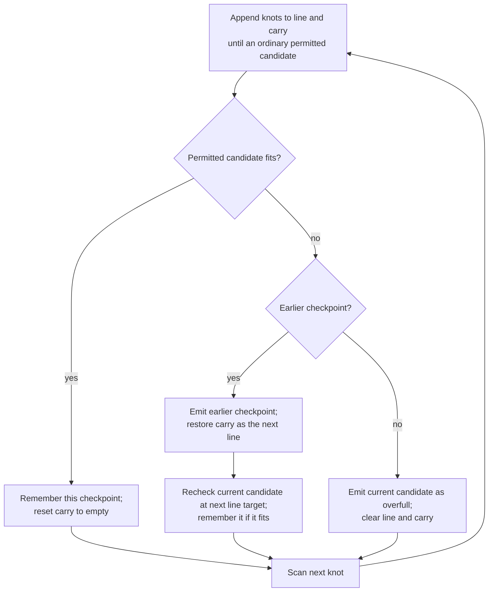

# First-Fit Line Breaker

Reflow PR 1 (2026-11-19) replaced the mutable input/selection API described in
older examples below. Current usage is in [reusable material](PREPARED_PARAGRAPHS.md)
and [the executable examples](../example_test.go): prepare `Khipu` + `Discovery`,
bind advances, break into `Tikray`, then `Freeze(plan)`. Selection state is private
to each trial; no public mutable candidate/selection table or owner provider is
supported. Public typesetting APIs have no context. The detailed algorithm and
geometry derivations below remain applicable; old API sketches and benchmark
measurements are pre-migration evidence, not current call signatures or costs.


Reference for `linebreak/firstfit`. It describes the contract, the algorithm,
its parameters and its deliberate limits. The paragraph-level design is in
[KHIPU_ALGORITHM.md](KHIPU_ALGORITHM.md#first-fit); the optimizing alternative
is described in [KNUTH+PLASS.md](KNUTH+PLASS.md).


## Overview

First-fit is a greedy, single-pass breaker. It scans the paragraph once,
remembers the latest breakpoint at which the current line still fits, and
commits that breakpoint as soon as a later candidate no longer fits. It can
rescue an overflowing word by hyphenating it.

It neither shapes text nor assigns final widths. Its result is a sequence of
breakpoints, plus the discretionary variants chosen at some of them. Freezing
turns that result into fixed-width lines.


## API

```go
func BreakParagraph(khp *khipu.Khipu, layout khipu.Params, params *Parameters) ([]int, error)
func DefaultLayout(shape khipu.LineShape) khipu.Params
func NewDefaultParameters() *Parameters
```

**Input.** A paragraph produced by `Khipukamayuq.EncodeParagraph`, or an
equivalent hand-built `Khipu`, ending with a non-discardable paragraph-fill knot
that carries a forced break.

**Geometry.** Line shape and side skips come from `layout` (`khipu.Params`).
`DefaultLayout(shape)` resolves a ragged-right profile: zero left skip and a
zero-width right skip with `fil` stretch and no shrink. Callers apply overrides
afterwards (explicit zeros are kept) and must pass the same `Params` to
freezing. Left and right are physical edges, also in RTL paragraphs.

**Algorithm parameters.** `params` holds `MinHyphenGain` and the optional
`DiscretionaryProvider`. `nil` selects `NewDefaultParameters()`: zero gain and
no provider.

**Result.** Zero-based indices of line-ending knots, the last one being the
paragraph fill. Discretionary choices are stored in
`Khipu.SelectedDiscretionaries`, keyed by the knot whose textbox is split. Base
knots and width planes are not changed.

**Ownership and side effects.**
- Selections are collected during the scan and replace
  `SelectedDiscretionaries` only when the call succeeds. A successful run
  without hyphenation clears earlier selections.
- A failed call returns no breakpoints and leaves earlier selections untouched.
  Discovery may still have added candidates to the paragraph's cache.
- Providers must not modify the selection map themselves.
- A `Khipu` must not be broken concurrently.


## Algorithm

The breaker scans knots in logical order and keeps:
- the bookkeeping of the current line (total width, leading and trailing
  discardable width, whether content has been seen);
- the **checkpoint**: the latest permitted breakpoint at which the line fits;
- the **carry**: the material scanned since the checkpoint, with the same
  bookkeeping, ready to start the next line.

For every knot:

1. **Forced break.** The line ends here. If the line no longer fits and a
   checkpoint exists, the checkpoint is committed first, so the material after
   it forms a line of its own before the forced break.
2. **Overflowing textbox.** If a textbox makes the line overflow, a
   discretionary rescue is attempted (see [Discretionary Rescue](#discretionary-rescue)).
3. **Prohibited break.** Nothing else happens.
4. **Permitted break that overflows.** The checkpoint is committed and the
   carry becomes the new line. The current candidate is then checked against
   the next line's target and becomes the new checkpoint if it fits there.
   Without a checkpoint, the line is ended here as an overfull line.
5. **Permitted break that fits.** It becomes the new checkpoint and the carry
   is reset.

The final knot is always the last breakpoint.

### Checkpoint And Carry Transitions

This diagram follows **ordinary permitted candidates**, after any discretionary
rescue attempt. The carry accumulates the scanned material after the current
checkpoint; accepting a newer checkpoint resets that carry.



For fixed advances `A=20`, `B=20`, `C=20` and spaces of 5, a target of 50 can
retain `[A][space][B]` at width 45. If the checkpoint is after the following
space, scanning `C` overflows the line: commit that checkpoint, trim its trailing
space, and restore `[C]` from carry. `C` is not scanned twice.

| Other transition | State after committing |
| --- | --- |
| Forced break | If overfull with a checkpoint, emit that checkpoint first; then emit the forced endpoint and clear line/carry. No rescue crosses it. |
| Successful discretionary rescue | Emit the textbox with its selected pre-break fragment; seed the next line with the post-break fragment and clear the ordinary checkpoint. |
| Provider error | Abort without publishing partial selections; previously published selections remain. |

Line/carry/checkpoint state and staged selections live for one breaker call.
Paragraph candidate caches can survive the call, including discoveries made
before a later error. Only complete success replaces the input's selections.

### Fitting

A line **fits** when its effective minimum width is at most the target:
`MinW ≤ LineLength(n)`, after trimming and including both side skips. The same
test applies to ordinary candidates, the carry, the overflow check at forced
breaks and discretionary fragments.

Natural-width overflow alone is therefore no reason to break earlier: if the
knots can shrink enough, the line is kept. With the ragged-right profile:
- surplus space goes to the highest stretch order present; the `fil` right skip
  keeps finite spaces at natural width, and the paragraph's `fill` wins on the
  last line;
- missing space is taken from the knots' finite shrink, since the right skip
  has none.

Content that must not be compressed has to be supplied with
`MinW = W = MaxW`, for example by setting `SpaceShrinkPercent` to zero when
encoding. There is no separate fitting-mode parameter. Breaking only chooses
endpoints; freezing assigns the widths.

### Trimming

The `KFDiscardable` flag, not the knot kind, decides what is removed at line
edges. Discardables between content count toward the width. The carry keeps the
complete bookkeeping, so leading discardables are trimmed on following lines as
well. The paragraph fill must not be flagged discardable.


## Discretionary Rescue

Rescue is attempted when a textbox makes the current line overflow and the
break after it is not forced. It requires either a checkpoint on the current
line or an explicit marker (U+00AD) in the textbox; an explicit marker can thus
also split the first word of a line. Whether a textbox is eligible for
automatic hyphenation is decided by the provider.

Alternatives come from the `DiscretionaryProvider`, normally the paragraph's
`Khipukamayuq`; without a provider, only cached alternatives are used. Each
alternative is checked in turn:

1. Its `PreBreak.Penalty` must not prohibit the break.
2. The line ending with its `PreBreak` fragment must fit (minimum width).
3. Its natural width must exceed the checkpoint line's natural width by at
   least `MinHyphenGain` (inclusive; the default 0 accepts no gain). Without a
   checkpoint, the comparison is against zero.

Among the remaining alternatives, the widest line wins; a lower penalty decides
ties, and the provider's order decides exact ties. The chosen `PostBreak`
fragment starts the next line. If no alternative qualifies, the scan continues
as if there were none.

Finite penalties do not compete with width, and `MinHyphenGain` filters single
choices; it does not limit how often lines are hyphenated.


## Limits

First-fit is deliberately simple. It does not offer:
- badness, tolerance or demerits, or any optimization across lines;
- more than one pass;
- hyphenation of a word already on a line that is too long (tight-line
  hyphenation), or automatic hyphenation of a first word without a checkpoint;
- several splits of one textbox, or splits spanning several textboxes;
- limits on consecutive hyphenated lines;
- reporting of overfull lines beyond an info-level trace message.

Overfull lines arise when a word is wider than the line and cannot be
hyphenated. Freezing them is a separate concern (see
[KHIPU_ALGORITHM.md](KHIPU_ALGORITHM.md#over--and-underfull-lines-1)).


## Performance Characteristics

The scan is linear in the number of knots, with constant-size line and carry
bookkeeping. Discretionary rescue adds the cost of the provider (source
preparation and fragment shaping), which dominates when hyphenation is
productive. Debug messages are only formatted when debug tracing is enabled.

Benchmarks and current measurements are in [PERFORMANCE.md](PERFORMANCE.md#first-fit).


## Code Reading Guide

| File | Contents |
|---|---|
| `doc.go` | package overview |
| `parameters.go` | algorithm parameters, default layout and penalty limits |
| `break.go` | `BreakParagraph` and its sequential greedy scan |
| `segment.go` | current-line widths, edge trimming and checkpoint carry |
| `discretionary.go` | provider contract, candidate eligibility and rescue selection |

Shared width arithmetic (`WSS`) and the rectangular shape live in package
`linebreak`.


## Tests

The package tests cover checkpoint and carry handling, forced breaks and
overfull fallback, trimming of flagged and unflagged boundary knots, the
discretionary eligibility and ranking rules, failure-atomic publication of
selections and cache reuse. Root-package integration tests break paragraphs
and freeze the result for fixed-width content, finite shrink, fill precedence
and LTR/RTL paragraphs.
