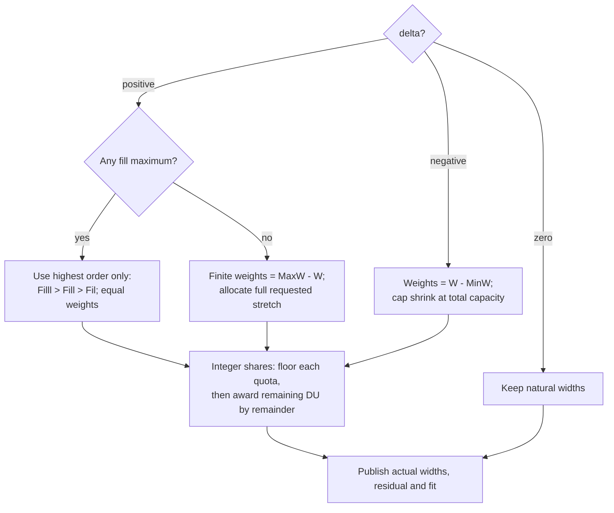

# Freezing A Khipu

Freezing is implemented. It materializes a complete linebreak decision and
assigns final widths, returning an opaque `FrozenKhipu`. This guide describes
current behavior as of November 15, 2026; the earlier implementation plan has
been superseded. Query types, coordinates, and ownership are specified in
[FROZEN-API.md](FROZEN-API.md).

## Public API

```go
frozen, err := owner.Freeze(ctx, input, breaks, layout)
```

Use the owner that encoded or bound `input`, a nonnil context, and the same
resolved `Params` (shape and physical side skips) used for breaking. `breaks`
contains strictly increasing line-ending knot indices through the final trailer.
The input's `SelectedDiscretionaries` must still belong to that breaker run.
Freeze before rerunning a breaker, since indices alone do not capture variants.
See the complete [public example](../example_test.go).

Freezing leaves the elastic input intact. It does not reshape, discover
alternatives, choose new breaks, or render glyphs. No unfreeze operation exists;
retaining the original input permits a separate future break/freeze operation.

## Materialization And Ordering

The implementation proceeds through explicit stages:

1. [Logical materialization](../logical_lines.go) validates ownership, aligned
   storage, complete breaks, trailer identity, and selected fragment provenance.
   A selected textbox is replaced by its pre-break fragment and a post-break
   carry for the next line. Required breaks cannot be skipped.
2. Line-edge discardables are trimmed. Non-discardable text and atomic items
   shelter intervening spaces, even when an atomic advance is zero or negative.
   Neutral retained material such as final fill does not shelter spaces.
   Source coverage still includes trimmed bytes.
3. [Line ordering](../line_ordering.go) clones retained bidi resolution, splits
   it into lines, applies the L1 approximation below, and obtains orderings.
   [Knot mapping](../knot_ordering.go) permutes whole source-backed knots into
   physical left-to-right order. Glyph arrays within boxes are not reversed.
4. [Generated placement](../generated_placement.go) puts paragraph fill at the
   paragraph's trailing visual edge: right for LTR and left for RTL. Unknown
   zero-source material has no attachment policy and is rejected.
5. [Geometry preparation](../line_geometry.go) snapshots one inclusive target
   width per line and keeps physical left/right skips outside the content knots.
   [Width allocation](../width_allocation.go) computes final widths before
   [publication](../frozen.go).

Atomics retain occurrence IDs and fixed signed advances throughout these stages.
They are never shaped, trimmed, or hyphenated. Their vertical geometry and actual
payload remain the caller's responsibility.

### Accepted L1 Approximation

The trailing contiguous original source-glue interval is recorded before trimming
and reset for bidi ordering. The paragraph trailer is ignored for this purpose;
source gaps, kerns, textboxes, and replacement fragments stop the suffix scan.

This is not full UAX#9 L1. NBSP or suppressed soft hyphens included in source glue
can be over-reset; omitted controls, whitespace inside text clusters, and
segment separators can be missed. See [trailingGlueL1](../line_ordering.go).
Neither widths nor discardability flags alone define the L1 interval.

## Width Allocation

Only glue adjusts in the current realization policy. Every non-glue content knot
must have `MinW == W == MaxW`, even when the requested target would not require
changing it. Otherwise `Freeze` returns `ErrUnsupportedAdjustment`: changing a
textbox width without matching shaping would leave stale glyph metrics. Side
skips act as glue by role regardless of their incidental knot kind or flags.

Targets and natural widths must be finite, below `dimen.Fil`. Individual finite
signed contributions are supported, but negative completed content or
skip-inclusive line totals return `ErrUnsupportedPolicy`. Invalid ranges,
overflow, and inconsistent geometry are errors.

Allocation uses the following rules:

- Stretch uses only the highest present fill order: `Filll > Fill > Fil`.
  Items of that order share equally; other items retain natural width. There
  are no separate fill weights. `Infinity` is not a supported fill order.
- Without fill, stretch shares are proportional to `MaxW - W`. Finite stretch
  may exceed those declared capacities, producing an underfull diagnostic.
- Shrink uses finite `W - MinW` capacities, including for glue with fill maxima.
  Shrink stops at minima; infinite shrink is unsupported.
- No stretch capacity leaves widths natural. Exact fit also leaves them natural.
- Integer shares use floors followed by largest-remainder apportionment, with
  ties resolved in input order (physical left-to-right for prepared geometry).
  Only diagnostic ratio/badness uses floating-point arithmetic.

The paragraph trailer is ordinary retained fill for allocation. Its configured
order competes with side skips, so no separate last-line justification policy is
applied. Knuth–Plass emergency stretch is virtual search capacity and is not added
to these physical capacities.

### Allocation Decisions And Rounding

For validated finite geometry, let `delta = target - natural`. Content is in
physical visual order, with LeftSkip first and RightSkip last for apportionment.



Zero total capacity leaves widths natural. For nonzero capacity, largest
remainders get the remaining single-DU shares; ties follow physical input order.
Finite stretch may exceed `MaxW`, but shrink never passes `MinW`. These are
allocation rules for glue and side skips, not permission to resize textboxes.

| Example (widths in DU) | Allocation and outcome |
| --- | --- |
| Two finite stretch capacities `(1, 2)`, requested growth `2` | Quotas `(2/3, 4/3)`, floors `(0, 1)`, then the larger remainder receives 1 DU: additions `(1, 1)`. |
| One `Fil` item and one `Fill` item, requested growth `6` | Only the `Fill` item grows, by 6; lower orders and finite glue stay natural. |
| Natural total `20`, finite maximum total `23`, target `26` | Stretch capacity 3, request 6: actual `26`, residual `0`, ratio `2`, **FitUnderfull**. |
| Natural total `20`, minimum total `16`, target `14` | Shrink capacity 4, request 6: actual `16`, residual `-2`, **FitOverfull**. |

Thus `Residual == 0` does not imply `FitWithinCapacity`: finite overstretch can
reach the target while exceeding declared capacity. Side skips and paragraph
fill participate in the same rules; virtual Knuth–Plass emergency stretch does not.

## Frozen Publication

All stages construct private output. A failure returns no partial result and
preserves the input and its decisions. Cancellation is checked between stages
and lines and after shape queries; it cannot interrupt a synchronous
`LineLength` call or one bidi/allocation operation.

Overfull and underfull lines are successful outcomes. `FrozenLine` exposes
`TargetWidth`, actual `Width`, signed `Residual = TargetWidth - Width`, `Fit`,
`Ratio`, `Badness`, and the winning `FillOrder`. Finite overstretch may reach the
target with zero residual while still reporting `FitUnderfull`. Bounded shrink
can leave a negative residual and `FitOverfull`. Fit status is physical capacity
information, not the breaker's optimization score.

Final line/knot/provenance storage is independently owned. Immutable shaping
records and source/font services are shared under their stable-lifetime
contracts. `CopyText` returns independent glyph, cluster, and feature slices;
`SourceReader` reads retained original bytes without flattening the paragraph.
Unused arena records may remain retained: arena compaction is not implemented.

## Limits And Further Work

Renderer boxes, drawing, baseline placement, and hit testing are outside this
API. Script-sensitive target-width shaping (for example kashida) would require
an explicit realization service and matching provenance before enabling elastic
non-glue material. General zero-source fragment attachment, full L1 treatment,
and arena compaction also require separate work.

Existing tests cover [public construction](../freeze_api_test.go),
[cancellation](../freeze_cancellation_test.go), [fit outcomes](../width_outcomes_test.go),
[allocation](../width_allocation_test.go), and [result queries](../frozen_result_test.go).
