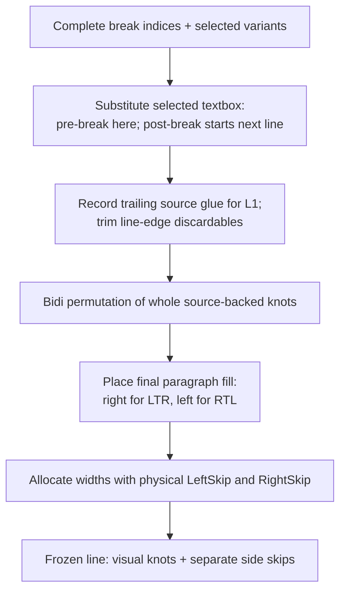
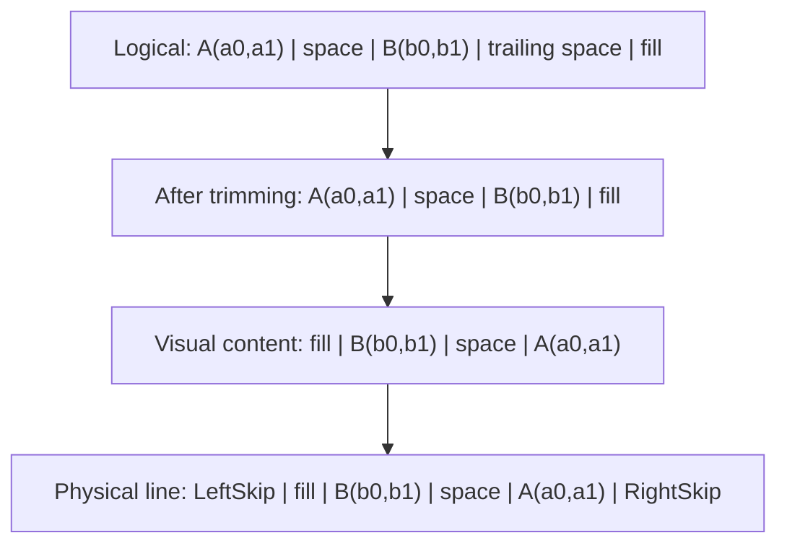
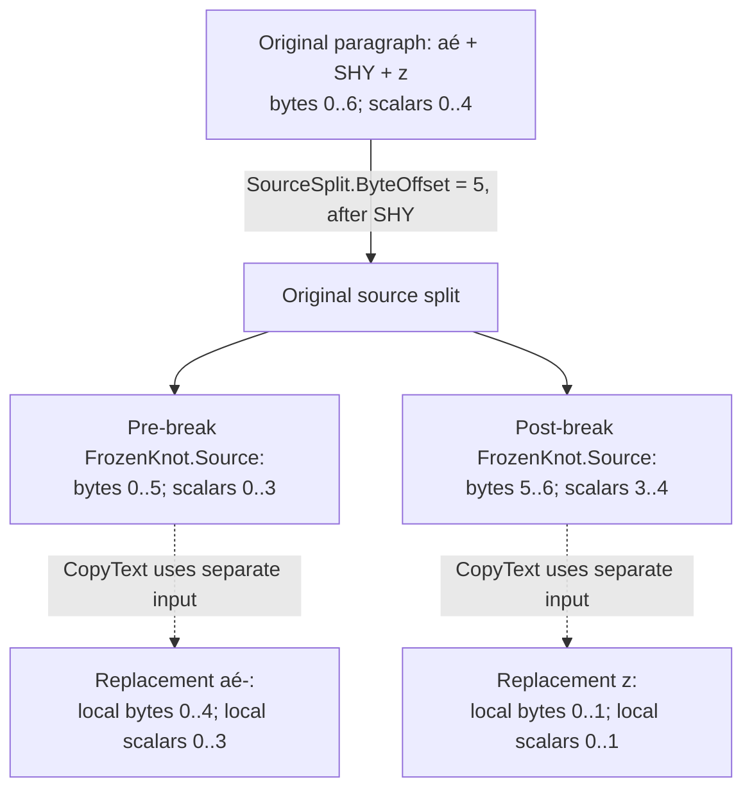

# Frozen Result Contract

Reflow PR 1 (2026-11-19) replaced the mutable input/selection API described in
older examples below. Current usage is in [reusable material](PREPARED_PARAGRAPHS.md)
and [the executable examples](../example_test.go): prepare `Khipu` + `Discovery`,
bind advances, break into `Tikray`, then `Freeze(plan)`. Selection state is private
to each trial; no public mutable candidate/selection table or owner provider is
supported. Public typesetting APIs have no context. The detailed algorithm and
geometry derivations below remain applicable; old API sketches and benchmark
measurements are pre-migration evidence, not current call signatures or costs.


Result queries and public construction are implemented in `frozen_result.go`
and `frozen.go`. `Khipukamayuq.Freeze` consumes complete break decisions and
resolved Params, returning an opaque `FrozenKhipu` or an error without partial output.
See [FREEZE.md](FREEZE.md) for allocation and ownership details.

Read [construction and shared geometry](#construction), [lines and knots](#lines-and-knots),
[text/glyph snapshots](#retained-text-and-glyphs), or [source and lifetime](#source-and-lifetime).
Completed implementation steps are in the [delivery record](history/FROZEN_API_DELIVERY.md).

## Scope

`FrozenKhipu` is an opaque result produced by its `Khipukamayuq`, with read access
to final lines, knots, original source and retained shaping data. SOA planes and
arena IDs are private. Queries return small records by value and copy variable-
length shaping data on explicit request; mutable width slices are not exposed.

The result is final layout data, not a new elastic paragraph, a renderer box,
or a serialized format. There is no unfreeze operation. Keeping the original
elastic input and freezing another break decision remains possible.

No baseline positioning, box construction, glyph reversal, drawing, hit testing,
or target-width shaping API is introduced by this contract.

Fixed-size atomic inline items are supported through `PrepareParagraph` and
`BindParagraph`. `Atomic(knotIndex) (contracts.AtomicID, bool)` identifies an
occurrence in physical visual order; invalid indexes and non-atomic knots return
false. `Knot` supplies its fixed signed advance and the original three-byte,
one-scalar U+FFFC source span. `CopyText` returns false for atoms. Atomics remain
content even with zero advance; their identity and geometry survive later working
paragraph changes. The caller retains all actual box/payload and vertical geometry.
Negative completed content or skip-inclusive line totals return
`ErrUnsupportedPolicy`; individual negative advances are supported. See
[the prepared-paragraph guide](PREPARED_PARAGRAPHS.md).

## Construction

Public signatures, in package `khipu`:

```go
type LineShape interface {
    LineLength(int32) dimen.DU
}
type Params struct {
    // Existing paragraph parameters remain here.
    LineShape LineShape
    LeftSkip, RightSkip KnotCore
}
func (kq *Khipukamayuq) Freeze(ctx context.Context, input *Khipu,
    breakpoints []int, params Params) (*FrozenKhipu, error)
```

All breakers use `khipu.LineShape` directly. The base package does not import
its linebreaker clients. LineShape remains an interface because
line lengths can vary, but is supplied through the existing Params rather than
a separate options object. KnotCore appears in paragraph configuration, never
in frozen output. There is no additional FreezeOptions type.

### Shared Geometry And Defaults

Params is the authority for paragraph geometry as well as its existing
paragraph-level settings. Both linebreakers and Freeze must consume the same
resolved LineShape, LeftSkip and RightSkip. Breaker-specific Parameters retain
algorithm controls, such as tolerances and MinHyphenGain, not duplicate skip
fields. Both breakers accept `BreakParagraph(input, layout Params, algorithmParams)`.

Resolve defaults once when preparing the paragraph's layout configuration, before
linebreaking. Pass that resolved Params value through breaking and freezing.
Passing Params by value snapshots the skip cores, but does not clone the object
behind LineShape: its behavior must remain stable across both phases. Freeze
must not consult changed owner defaults or apply breaker defaults again.

The firstfit default is **ragged-right**:

```go
LeftSkip:  KnotCore{Kind: KTGlue, W: 0, MinW: 0, MaxW: 0}
RightSkip: KnotCore{Kind: KTGlue, W: 0, MinW: 0, MaxW: dimen.Fil}
```

This is zero natural width plus symbolic first-order fill stretch, not a large
finite space. On underfull ordinary lines it absorbs the remaining width,
leaving finite interword spacing at its natural width. It does not eliminate
shrink when needed or change firstfit's greedy breakpoint policy. Right means
the physical right edge, including for RTL paragraphs; direction-relative
ragged alignment would be a separate policy, not an implicit reinterpretation.

The terminal paragraph fill retains its independent configured order and visual
placement. Normal fill precedence applies: a higher-order terminal fill absorbs
the final-line adjustment instead of the right skip; equal-order fills share it.

Knuth-Plass retains its existing finite-stretch right-skip default in its
default layout profile; selecting that profile initializes the same Params
fields, not a second authority during breaking/freezing. A common global Params
default cannot simultaneously express these two engine defaults. Explicit
caller-supplied values always take precedence, including zero skips. Do not
infer "unspecified" from a zero KnotCore: default profiles initialize values
before caller overrides, and resolved configuration is complete. A missing
LineShape is an error; no implicit paragraph width is invented.

`khipu.DefaultParams()` returns an independent complete base parameter value,
with zero side skips and no shape. `firstfit.DefaultLayout(shape)` and
`knuthplass.DefaultLayout(shape)` start from those defaults and select their
respective right-skip profiles (`Fil` and `50*BP`). They do not merge into existing
caller settings; initialize the chosen profile first, then apply overrides.
Nil algorithm parameters select algorithm defaults only, not paragraph geometry.

```go
layout := firstfit.DefaultLayout(shape)
// Set application-specific Params fields here; zero skips are valid overrides.
breaks, err := firstfit.BreakParagraph(input, layout, nil)
// Keep this same layout for freezing the returned decisions.
```

`Params.ValidateGeometry()` rejects absent/typed-nil shapes and invalid side-skip
width triples without querying the shape. Encoding does not require layout
geometry. Config copies Params values, retaining the LineShape service by
reference. Freeze uses these same resolved parameters without reapplying defaults.

Requirements:

- Input is an encoded paragraph owned by this Khipukamayuq, with a complete
  breakpoint list and the corresponding selected discretionary records.
- Params geometry must be identical to that used for linebreaking.
  No defaults are substituted. LineShape includes both physical side skips and
  uses one-based line numbers; each target is sampled once.
- Side skips are edge glue by role. Only W/MinW/MaxW matter, not their
  incidental Kind, Flags or Penalty.
- Non-glue content must currently be fixed-width, including selected fragments.
  Declared textbox elasticity is unsupported even if unused by this target.
- Construction is single-owner, not concurrency-safe. Source, services and
  input decisions must remain stable for the operation.

Success returns a complete independent final-width result. Failure returns nil
and an error, without changing the input or its selections. Insufficient capacity
is not an error: allocation publishes over-/underfull outcomes.
Finite stretch can exceed MaxW; shrink stops at MinW. With no stretch, natural
widths remain. The public line record exposes target and actual width,
signed residual, fit status, ratio, badness and fill order from that outcome.
No shaper/hyphenator is called in the current supported subset.

Pass a nonnil context. Cancellation is checked at entry, between stages and
lines, during logical knot scanning, after each LineLength call, and before
publication. It cannot interrupt a synchronous client LineLength call or a single
bidi/allocation operation. Cancellation returns
nil and an error matching `context.Canceled` or `context.DeadlineExceeded`.
Nil context returns ErrIllegalArguments. An already-canceled context takes
precedence over subsequent input validation. A new context can retry unchanged input.

Unsupported non-glue elasticity returns the exported
sentinel `ErrUnsupportedAdjustment`. There is no capacity-error sentinel. Continue to
use `ErrIllegalArguments` and `ErrVoidKhipukamayuq` for their existing cases.
Wrap errors with stage/line context; callers use `errors.Is`, not message text.

This contract cannot detect a stale breakpoint list that is structurally valid
against newly replaced selections, or a different but valid shape. Callers must keep
the geometry, breakpoints and selected discretionaries from the same run together.

## Lines And Knots

```go
type FrozenKhipu struct { /* private representation */ }
func (f *FrozenKhipu) LineCount() int
func (f *FrozenKhipu) KnotCount() int
func (f *FrozenKhipu) Line(index int) (FrozenLine, bool)
func (f *FrozenKhipu) Knot(index int) (FrozenKnot, bool)
type ByteRange struct { Start, End uint64 }
type SourceRange struct {
    Bytes ByteRange
    ScalarStart, ScalarEnd uint64
}
type FrozenLine struct {
    FirstKnot, KnotCount int
    Width, TargetWidth, Residual dimen.DU
    LeftSkip, RightSkip dimen.DU
    Source ByteRange
    Fit FrozenFit
    Ratio float64
    Badness int
    FillOrder dimen.DU
}
type FrozenFit uint8
const (
    FitWithinCapacity FrozenFit = iota
    FitUnderfull
    FitOverfull
)
type FrozenKnot struct {
    W dimen.DU
    Kind KnotType
    Flags KnotFlags
    Source SourceRange
    Material FrozenMaterial
}
type FrozenMaterial uint8
const (
    OriginalMaterial FrozenMaterial = iota
    PreBreakMaterial
    PostBreakMaterial
    ParagraphFillMaterial
)
```

All result indices are zero-based; this deliberately differs from LineLength's
one-based argument. Knot indices are global to this result, not indices in the
elastic input. Lines are in paragraph sequence; each line's contiguous knot
range is in physical left-to-right order, independently of base direction.
Queries return false for invalid indices, with no panic. Nil/zero results have
zero counts and unsuccessful lookups. Freeze is the public construction entry point.

Records are detached values. Changing a returned record does not alter the
result. No MinW, MaxW, Penalty, candidates or arena references are exposed.
Original knot indices and variant IDs remain private diagnostic provenance;
clients should consume the chosen material, not resolve its variant again.

`Width = LeftSkip + sum(content W) + RightSkip`, exactly in DU. Side skips
are separate physical slots, not source knots. Terminal paragraph fill remains
a content knot with its assigned finite width and an explicit material role.
Widths can be signed for supported signed input geometry; the line's inclusive
width is finite and nonnegative. Frozen flags are preserved metadata, not an
instruction to trim or reorder the already finalized line again.

`Residual = TargetWidth - Width`. Its sign describes trailing slack or protrusion.
`FitUnderfull` also covers finite overstretch that reaches the target exactly.
`Ratio` is the requested signed finite adjustment divided by capacity, with signed
infinity for absent capacity. Fill uses ratio/badness zero and a nonzero FillOrder
(`dimen.Fil`, `Fill`, or `Filll`). Exact natural fits have zero diagnostics.
Finite badness is rounded `100*abs(Ratio)^3`, capped at 10000; overfull lines
always report 10000. These are physical diagnostics, not breaker demerits.

Source ranges are half-open and paragraph-relative. Lines cover untrimmed input;
knot ranges describe original provenance, including for changed-spelling
fragments. Visual knot ranges need not be monotonically ordered by source.
Generated paragraph fill has an empty source range. Silent replacement material
is still a knot and may have a nonempty original source range.

Prefer SourceRange over a second public Pos/Len pair: it avoids mixing absolute
positions, paragraph-relative positions and the internal uint16 Len field.

### From Logical Material To A Visual Line



For a short RTL paragraph whose logical text is `אב xy `, let `A` be the RTL
textbox and `B` the LTR textbox. Assume each is represented by one box. The
labels `a0,a1` and `b0,b1` denote retained glyph-array order, not pen positions.
Each row below is drawn left to right; the first row lists **logical** items.



The trailing source space is removed from visible material but remains in line
source coverage. Final fill follows paragraph direction, not the direction of
`B`. Side skips are physical edges and are not content knots. Neither bidi
permutation nor freezing reverses glyph arrays within a box. The example does
not claim full UAX#9 L1 handling; the accepted approximation is described in
[the freezing guide](FREEZE.md#accepted-l1-approximation).

## Retained Text And Glyphs

Consumers must be able to obtain shaping data without learning arena IDs or
assuming that every textbox contains glyphs. Use an explicit snapshot operation:

```go
func (f *FrozenKhipu) CopyText(knotIndex int) (FrozenText, bool)
type FrozenText struct {
    Glyphs []contracts.ShapedGlyph
    Clusters []FrozenCluster
    Context FrozenTextContext
    IsReplacement bool
    ReplacementText string
}
type FrozenCluster struct {
    Input SourceRange
    FirstGlyph, GlyphCount int
}
type FrozenTextContext struct {
    Input SourceRange
    Params contracts.ShapeParams
}
```

CopyText returns false for invalid indices or knots without retained text
shaping. A silent textbox returns true with empty Glyphs/Clusters. The boolean
must not be inferred from glyph count. The call copies glyphs, cluster records
and Params.Features; mutating those slices cannot affect frozen storage.
Params.Font is an immutable contracts.FontInstance; its Face() and Scale()
remain shared immutable services. ReplacementText is an
immutable string; IsReplacement distinguishes an empty replacement from ordinary
source-backed text. Repeated calls make independent snapshots, costing
O(glyphs + clusters + features) time and storage for the requested knot only.

Glyph order, IDs, advances and offsets are exactly the retained shaping output,
not physical pen positions. Positions remain in signed font units, with Params.Font.EmSize()
and Params.Font.Scale() for interpretation; they are not silently converted or rounded to DU.
Direction comes from Context.Params. The outer visual permutation never reverses
glyph arrays. Subsequent box creation must interpret these records according to
the shaping contract rather than infer glyph direction from line order.

Cluster FirstGlyph/GlyphCount are rebased to the returned Glyphs slice, not the
arena. Coordinate domains are explicit:

- Ordinary text: cluster Input ranges and glyph scalar anchors refer to the
  original paragraph. Context.Input is the original prepared run, possibly
  larger than this knot. Feature ranges remain relative to that run.
- Replacement text: cluster Input ranges and glyph anchors refer to the stored
  replacement input starting at zero. Context.Input and feature ranges refer
  to that replacement run. FrozenKnot.Source still refers to original input.

Do not promise a character-by-character mapping from replacement glyphs back
to original text. Ordinary input also may contain omitted controls or explicit
markers; original source is provenance, not a guarantee of identical shaper
input. CopyText does not constitute a ready-to-replay reshaping request.

The copy-based design is a deliberate first contract, not a requirement to copy
the whole arena during Freeze. Indexed value access or copy-into-buffer methods
can be added later if profiling justifies them, without exposing backing slices.

### Replacement Coordinates

Use the source example `aé­z` from the
[coordinate ladder](../contracts/ReadMe.md#coordinate-ladder-multibyte-text-and-soft-hyphens).
Assume a configured explicit policy supplies `-` before the break and no added
post-break material. The owner forms `aé-` and `z` as complete replacement inputs.



`FrozenKnot.Source` remains original paragraph provenance; `CopyText` glyph
anchors, cluster `Input` and context `Input` refer to the replacement input.
Feature ranges are relative to that replacement run. The soft hyphen belongs to
pre-break provenance even though it is not shaped. A generated hyphen is not
mapped back to one original character. Add `SourceOffset()` only when converting
original paragraph byte positions into document positions; never add it to
replacement-local coordinates.

## Source And Lifetime

```go
func (f *FrozenKhipu) SourceOffset() uint64
func (f *FrozenKhipu) SourceLen() uint64
func (f *FrozenKhipu) SourceReader(span ByteRange) (io.Reader, error)
```

Capture the paragraph offset at construction. Absolute source positions are
SourceOffset plus paragraph-relative byte positions; accessors otherwise never
mix these domains. SourceLen is the original paragraph's UTF-8 byte length.
SourceReader validates `Start <= End <= SourceLen` and returns a fresh bounded
reader over the retained cord, without converting the paragraph into a string.
Byte ranges may be arbitrary byte boundaries; semantic ranges returned above
use valid source boundaries. Invalid ranges or nil/zero results return
ErrIllegalArguments; a valid empty range returns an empty reader.

Queries do not expose the mutable `*styled.Paragraph`, bidi levels, source style
objects or owner. The stable-source lifetime requirement still applies: source,
published arena records and external font services must remain immutable.
The result retains references and does not depend on the owner staying alive
or on the elastic input's mutable slice headers, caches or selections.
Freeze does not promise a deep copy of arbitrary external services or styles.

Final planes are independently owned; immutable shaping data can remain shared.
Only shaping records associated with result knots are publicly accessible.
Unused candidate records may still be retained internally until compaction is
implemented; their presence must not leak into counts or traversal.

The frozen object supports concurrent reads under these lifetime contracts.
Each returned reader has an independent cursor, but a single reader is not
promised concurrent use. There is no Close or invalidation when the owner is
reused. Frozen output is not a persistent/portable font serialization format.

## Verification And History

Current guarantees and executable evidence are indexed in the
[testing guide](TESTING.md#guarantees-and-evidence). The completed migration and
verification narrative is preserved in the [delivery record](history/FROZEN_API_DELIVERY.md).
