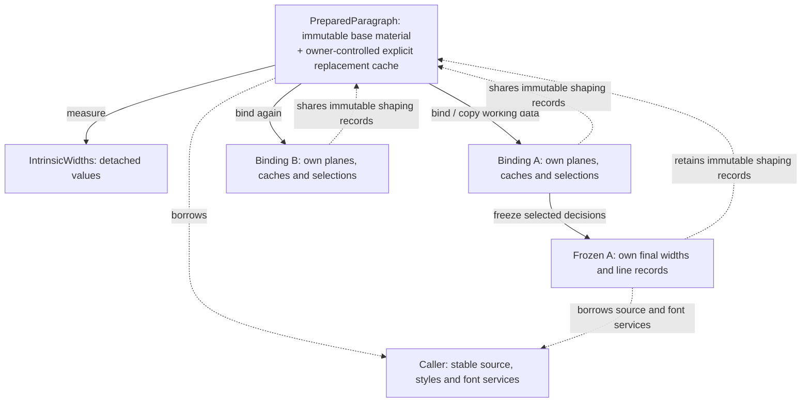

# Prepared Paragraphs: Measure, Bind And Lay Out

Use a prepared paragraph when text contains opaque inline items, when you need
intrinsic widths, or when the same shaped text will be laid out with different
atomic advances. Text-only callers who need a single layout can start with
[`EncodeParagraph`](../README.md#encode-and-break-a-paragraph).

This is the current client guide for `ParagraphInput`, `PrepareParagraph`,
`MeasureIntrinsic` and `BindParagraph`. Exact declarations and validation rules
are documented in [paragraph_input.go](../paragraph_input.go),
[intrinsic.go](../intrinsic.go) and [contracts/atomic.go](../contracts/atomic.go).
The [pipeline integration record](PIPELINE_INTEGRATION.md) preserves the earlier
cross-repository design and implementation evidence.

## Workflow

| Step | Call | Result and reuse |
| --- | --- | --- |
| Prepare | `owner.PrepareParagraph(ctx, input, options)` | Shapes base text once, retains source metadata and unbound atomic slots. |
| Measure, if needed | `owner.MeasureIntrinsic(ctx, prepared, request)` | Computes natural min/max-content widths without binding or breaking. Repeat with new atomic ranges. |
| Bind | `owner.BindParagraph(ctx, prepared, advances)` | Creates an independent working `Khipu` with fixed atomic advances. Repeat without reshaping base text. |
| Break | Either breaker's `BreakParagraph(input, layout, params)` | Chooses line endings and records selected discretionaries on that binding. |
| Freeze | `owner.Freeze(ctx, input, breaks, layout)` | Produces immutable final widths, visual knot order and source/atomic identities. |

Resolve the layout once and reuse it unchanged for breaking and freezing.
Freeze before another successful breaker call replaces that binding's selected
discretionaries. Measurement can run before or after layout and does not consume
the preparation. Vertical box geometry, baselines and drawing belong to callers.

### Ownership And Reuse

Solid arrows create results or copy working data. Dashed arrows are retained
references, not ownership transfers. All calls on the creating owner are serialized.



The dashed arrows to the preparation denote shared records, not a requirement to
keep its handle alive. Frozen results do not depend on binding A's mutable slice
headers or selections, or on the owner remaining alive. Rebinding or rebreaking
cannot invalidate an earlier frozen result; caller-owned source and services
must still obey their stable-lifetime contracts. The preparation's explicit cache
is memoization controlled by the owner, not client-mutable base text.

## Anchors And Atomic Boundaries

Insert one U+FFFC OBJECT REPLACEMENT CHARACTER per attached occurrence into the
styled paragraph. Each `contracts.AtomicAnchor` supplies a nonzero ID, unique
within that paragraph, and the marker's first **paragraph-relative UTF-8 byte**
offset. Anchors must be strictly ordered by offset. They are not rune indices
or absolute document positions. For `"A \uFFFC B"`, the marker starts at byte 2
and occupies bytes `[2, 5)`. Unattached U+FFFC remains ordinary text.

Attached atoms participate in source-boundary and bidi analysis, but bypass text
shaping and style/font resolution. They are content even with zero or negative
advance, and are never trimmed or hyphenated. Khipu retains occurrence identity;
keep the actual object/payload and its vertical geometry in caller-owned storage.

`PrepareOptions.AtomicBoundaries` optionally supplies sorted, unique overrides
at interior edges immediately before or after an attached atom. `AllowBoundary`
permits an ordinary zero-penalty break; `ProhibitBoundary` forbids an optional
break. Omitted edges retain Unicode policy. Paragraph endpoints cannot be
overridden, and mandatory breaks cannot be downgraded. There is no mandatory
override action.

## Complete Example

This program prepares one inline occurrence, measures it, then binds and freezes
two different advances. It uses **synthetic shaping**, requires no font files,
and does not demonstrate real typography. Save it as `main.go` in a separate
directory in this checkout and run `go run .` there; see the
[dependency setup](TESTING.md#dependency-release-checks).

```go
package main

import (
	"context"
	"fmt"

	"github.com/npillmayer/cords/styled"
	"github.com/npillmayer/khipu"
	"github.com/npillmayer/khipu/contracts"
	"github.com/npillmayer/khipu/dimen"
	"github.com/npillmayer/khipu/linebreak"
	"github.com/npillmayer/khipu/linebreak/firstfit"
	"github.com/npillmayer/uax/bidi"
)

func main() {
	ctx := context.Background()
	text := styled.TextFromString("A \uFFFC B")
	para, err := styled.ParagraphFromText(&text, 0, text.Raw().Len(), bidi.LeftToRight, nil)
	if err != nil {
		panic(err)
	}
	owner := khipu.NewKhipukamayuq(khipu.Config{})
	prepared, err := owner.PrepareParagraph(ctx, khipu.ParagraphInput{
		Paragraph: para,
		Atomics:   []contracts.AtomicAnchor{{ID: 1, ByteOffset: 2}},
	}, khipu.PrepareOptions{}) // NoHyphenation is the default.
	if err != nil {
		panic(err)
	}
	widths, err := owner.MeasureIntrinsic(ctx, prepared, khipu.MeasureRequest{
		Atomics: []khipu.AtomicIntrinsic{{ID: 1, MinAdvance: 20 * dimen.PT, MaxAdvance: 30 * dimen.PT}},
	})
	if err != nil {
		panic(err)
	}
	fmt.Println("intrinsic pt:", int64(widths.MinContent/dimen.PT), int64(widths.MaxContent/dimen.PT))

	layout := firstfit.DefaultLayout(linebreak.RectangularParShape(100 * dimen.PT))
	for _, advance := range []dimen.DU{20 * dimen.PT, 30 * dimen.PT} {
		input, err := owner.BindParagraph(ctx, prepared, []khipu.AtomicAdvance{{ID: 1, Advance: advance}})
		if err != nil {
			panic(err)
		}
		breaks, err := firstfit.BreakParagraph(input, layout, nil)
		if err != nil {
			panic(err)
		}
		frozen, err := owner.Freeze(ctx, input, breaks, layout)
		if err != nil {
			panic(err)
		}
		for i := 0; i < frozen.KnotCount(); i++ {
			if id, ok := frozen.Atomic(i); ok {
				knot, _ := frozen.Knot(i)
				fmt.Println("atomic", id, "advance pt:", int64(knot.W/dimen.PT))
			}
		}
	}
}
```

The program reports:

```text
intrinsic pt: 20 50
atomic 1 advance pt: 20
atomic 1 advance pt: 30
```

The [public Go examples](../example_test.go) also exercise preparation/rebinding
and text-only intrinsic measurement. For a paragraph without attached atoms,
omit `ParagraphInput.Atomics`, use `MeasureRequest{}`, and bind with a nil slice.

## Measurement And Binding Contracts

Both requests require exactly one entry per attached ID, in any order. Duplicate,
missing or unknown IDs are invalid. Request slices are consumed without being
retained. Advances include any caller-resolved horizontal margins; they are not
border-box sizes or elastic capacities.

- `AtomicIntrinsic` supplies ordered signed `MinAdvance`/`MaxAdvance` values.
  Both endpoints must have magnitude less than `dimen.Fil`.
- `AtomicAdvance` supplies a fixed signed advance with magnitude less than
  `dimen.Fil`. Binding does not consult earlier measurements or enforce that a
  chosen advance lies within a previously queried range.

Min-content takes supported optional breaks; max-content suppresses them. Both
respect mandatory boundaries and trim discardables using layout's content rules.
Natural text/glue advances contribute; side skips, paragraph fill, stretch/shrink
and breaker scoring do not. Signed sums are checked and normalized after complete
spans: `MinContent >= 0` and `MaxContent >= MinContent`, both below `dimen.Fil`.
These bounds do not guarantee a particular line count or a successful negative-
advance layout: freezing rejects negative completed content or line totals.

## Hyphenation Policies

The mode is fixed at preparation and applies to every binding. `EncodeParagraph`
is the separate text-only entry point and does not take `PrepareOptions`.

| Mode | Bound paragraph layout | Intrinsic measurement |
| --- | --- | --- |
| `NoHyphenation` (zero/default) | Ordinary wrapping; no explicit or automatic discovery. | Supported. |
| `ExplicitHyphenation` | Authored U+00AD alternatives through the owner. | Supported with at most one eligible split position and one break-permitting material variant per textbox. |
| `AutomaticHyphenation` | Automatic and explicit alternatives through the owner. | Returns `ErrUnsupportedPolicy`; no silent fallback to ordinary widths. |

Enabled modes require `Config.Hyphenator` at preparation. For layout, also set
the breaker's `Parameters.DiscretionaryProvider` to that owner. Each breaker
retains its own discovery schedule; enabling a mode does not guarantee every
alternative is queried. `Config{}` alone supplies no discretionary material.

Explicit measurement shapes replacement pairs lazily and memoizes complete
batches, including successful empty responses, on the preparation. Later queries
and explicit-mode bindings reuse them; a binding imports them only when its
provider is asked. Multiple eligible positions or permitting variants per textbox
are unsupported in measurement, as are successive splits of the same textbox.
See [the provider contract](HYPHENATION.md) for replacement source coordinates,
penalties and cache rules.

## Ownership And Errors

Use the same owner for preparation, measurement, binding and freezing. Serialize
operations on an owner. Keep source text, styles, font services and provider
policy stable for all derived results; request slices may be reused after calls.
Bindings own their mutable planes, caches and selections. Immutable shaping
records and source remain shared. There is no `Close` on a preparation.
Glyph coverage and font fallback remain caller responsibilities.

Pass a nonnil context to owner operations. They return no partial paragraph or
frozen result on failure; measurement returns zero widths and leaves its
preparation reusable. Errors preserve wrapped causes; use `errors.Is`.

| Error | Typical cause |
| --- | --- |
| `ErrIllegalArguments` | Malformed anchors/ranges, ID mismatch, wrong owner, missing enabled hyphenator, nonfinite widths or invalid context. |
| `ErrVoidKhipukamayuq` | Calling through a nil owner. |
| `ErrUnsupportedPolicy` | Automatic intrinsic hyphenation, unsupported explicit measurement, a mandatory boundary override, or negative completed freeze totals. |
| `ErrUnsupportedAdjustment` | Freezing elastic non-glue material. |
| Context/backend error | Cancellation, deadline or collaborator failure. |

Cancellation cannot interrupt every synchronous backend/source operation.
Breakers have no context argument; an encoding/freezing context does not cancel
their search or lazy provider calls. Failed breaker calls preserve prior
selections but may leave successfully discovered candidates cached.

Frozen `Atomic(index)` identifies occurrences in visual knot order; `Knot(index)`
supplies final width and original source range, while `CopyText(index)` returns
false for atoms. For physical allocation and result lifetime, continue with
[freezing](FREEZE.md) and [the frozen result contract](FROZEN-API.md).
