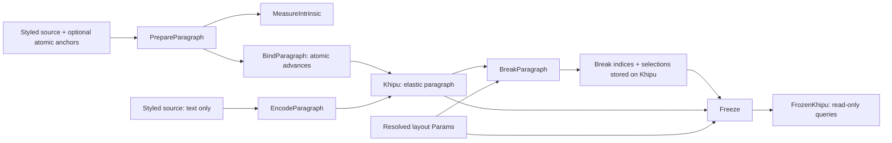

# Review: preparing Khipu for human clients

Reviewed November 15, 2026, against commit
`ce842a4694802185d57bb5b3f9bd8857b12b80db`.

The original review found a strong implementation foundation but inconsistent
client documentation: current contracts were mixed with earlier designs, several
guides contradicted working code, and central public declarations lacked comments.
The final verification below describes the corrected working tree.

This review covers unused code, package/API comments, godoc, package READMEs,
file size, topic locality, and useful diagrams. The original findings remain
below as a baseline; the status and verification sections record their resolution.

## Final verification — November 15, 2026

**R01–R10 are addressed.** The final review covered the complete working-tree
change set against the reviewed commit, including new files that are not yet
tracked by Git. No new runtime regression was found in that change set. This is
completion of the review findings, not a claim of release or backend conformance.

| Finding | Final disposition |
| --- | --- |
| R01: contradictions and links | Addressed. Current guides match the implemented workflows and errors; the final pass also corrected stale inline-object, fallback, retirement and elastic-textbox descriptions in the overall algorithm guide. |
| R02: core API comments | Addressed. Core storage, queries, mutations, errors and enums have contracts. The final pass attached individual godoc comments to fill orders and paper presets, including their legacy dimensions and shared mutability. |
| R03: inaccurate source comments | Addressed. Preparation, streaming, discovery cancellation, parameter precedence and width-summary arithmetic describe current behavior. |
| R04: usable configuration and export scope | Addressed compatibly. `Merits` supports typed conversions; incidental names are deprecated but retained. Search is independent of mutable `NoBreakRef`. |
| R05: package entry points | Addressed. All nine Go package directories have a README and an attached package comment; examples cover both input workflows and the shared utility packages. |
| R06: unused private code | Addressed. The identified dead declarations are absent; the reference scan found no remaining private function with zero syntactic production references. This is not a whole-program dead-code proof. |
| R07: test scaffolding and metadata | Addressed. Useful wrappers live in test files; redundant frozen and cluster fields are removed while public provenance and replacement queries remain tested. |
| R08: file size and locality | Addressed. Both breaker entry files are split by responsibility, and related root operations are grouped. Only the cohesive Knuth–Plass discretionary implementation exceeds 300 production lines (335). |
| R09: current guides versus history | Addressed. Client navigation is separate from preserved implementation records. The final pass reconciled the overview's remaining contradictions with the detailed contracts. |
| R10: explanatory diagrams | Addressed. Eleven diagrams cover lifecycle, ownership, stream outcomes, coordinates, storage, visual order, state transitions and allocation, with prose/examples alongside. |

### Final-pass corrections

The overview still described atomic representation as unresolved and depicted
retirement before rescue/fallback, despite the current detailed guide and R10
diagram. It now describes the implemented atomic workflow and boundary transaction:
advance, discover/rescue, commit, insert fallback while sources are live, then
retire working state while retaining predecessor history. It also distinguishes
numerical search fill scoring from symbolic freeze allocation, documents
replacement-local coordinates, and removes unconditional success and elastic-
textbox implications. These were documentation gaps, not runtime changes.

The fill and paper-preset comments were incomplete in generated godoc because
comments preceding separate declarations applied only to the first symbol.
Each now has its own explanation. Numeric preset values are preserved; the
legacy US paper presets are not represented as exact inch dimensions.

### Verification evidence

- Compared production declarations against the original commit, ignoring
  comments and file moves. Of 457 original declaration groups, 420 are unchanged;
  all remaining differences were reviewed as the documented removals, metadata
  cleanup, aliases/private names or sentinel isolation. After normalizing aliases
  and renamed constants, only five retained function bodies differ: frozen
  publication, cluster completion and three sentinel-related lookup/commit paths.
- No public declaration name, method or field was removed. `Merits` is the only
  added public declaration. Existing field type identity, legacy constants and
  helper signatures are retained; external-package tests exercise typed score
  configuration and compatibility names.
- Passed `go test ./... -count=1 -timeout=30s`,
  `go test -race ./... -count=1 -timeout=90s`, `go vet ./...` and `go build ./...`
  with Go 1.25.6 on darwin/arm64. Public examples run with the suite.
- Extracted and ran the four complete Markdown programs (root quick start,
  prepared paragraphs, dimensions and custom line shape); their outputs match
  the guides. Both breaker README helpers compile as external client code.
- Checked all 461 local Markdown file/heading links and `git diff --check`.
  Verified that the preserved integration body and extracted history remain
  intact apart from rebased relative links. The eleven diagram sources are
  unchanged since their successful Mermaid 11.12.0 rendering and visual review.

### Remaining boundaries

- Deprecated exports remain intentionally available. Removing them is a future
  compatibility decision, not unfinished R04 cleanup. Score arithmetic retains
  its existing unchecked `int64` limits; typed configuration is not validation.
- Tests use the existing sibling `cords`/`uax` replacements and synthetic/scripted
  shaping. Published-dependency reproducibility, external client repositories,
  real font adapters and full Unicode conformance were not verified by this
  review. Follow [dependency release checks](TESTING.md#dependency-release-checks)
  before publishing.
- The existing bidi L1 approximation, unsupported target-width text shaping,
  intrinsic hyphenation limits and lack of arena compaction remain documented
  product boundaries. They were not introduced by this change set.
- The 58 sibling-checkout references in historical material and remote links
  are outside the portable local-link check; client navigation uses local guides.

## Implementation log — November 15, 2026

The entries below record each completed step in delivery order. Their counts
and statements about work remaining describe that step, not the final status
above. The finding descriptions farther below retain the original review snapshot.

R01 and R02 have been addressed: the testing/freezing guides now describe the
implemented pipeline, the algorithm/status and CLI claims are corrected, the
reported broken references are repaired, and core data/access/mutation APIs have
godoc contracts. The documentation index now links current prepared/intrinsic,
whitespace and diagnostic workflows. Related stale integration comments were
also corrected. The findings below remain the original review snapshot; their
line references describe the reviewed commit and may have moved.

R03 and R05 are now addressed as well: public comments describe discovery
cancellation, parameter precedence, streaming lifecycle/flush choices, and width
summary arithmetic; the five missing package READMEs now provide examples,
contracts and navigation. Package overviews and the root index include them,
and executable preparation/rebinding and intrinsic-measurement examples were
added.

R06 and R07 are now addressed: the unused root tracer, private badness constant,
formatting-helper chain, spacing aliases and disabled dimension parser are
removed. Useful preparation, producer, publication, scoring and path-projection
helpers now live in `_test.go` files; the redundant preparation wrapper and
obsolete non-discardable scans are removed. Lifecycle and publication contracts
remain beside the live production entry points, and test-bridge comments and the
scoring guide now reference the current implementation.

Frozen results no longer allocate duplicate position/length planes or retain
unused original-knot/variant IDs; clusters no longer store a duplicate penalty.
Source provenance, shaping boxes, atomic IDs and selected fragment kinds remain
available through the existing public queries. Freeze tests still verify source
ranges, replacement identity and independent output storage, while scan tests
continue to exercise the live textbox-only policy. Public APIs are unchanged.
Validation passed: the full test suite, a Knuth–Plass rerun after the final scan
removal, `go vet ./...`, `go build ./...`, and `git diff --check`. A reference
check confirmed the retired declarations are absent and relocated helpers occur
only in test files.

R08 is now addressed: Knuth–Plass has separate bookkeeping, evaluation, geometry,
scoring, search, result and diagnostic files; its entry/setup file is 106 lines.
First-fit now separates parameters, the sequential scan, segment/carry state and
discretionary rescue; its scan file is 189 lines. The cohesive knot accumulator,
line materialization, intrinsic measurement and width-allocation files remain
intact, as recommended by the review.

Owner construction is beside configuration; knot types, flags and flag access
are together in `knot_types.go`. Package introductions no longer house runtime
helpers: errors, assertions and tracing live beside their implementation topics.
`nilRunService` has a shared service-validation home, and `RuneReader` is in
`contracts/rune_reader.go`. Package READMEs and algorithm/source maps now point to
the new locations, including preparation, binding, atomics and measurement.
Historical file labels below are retained; the retired first-fit file link now
opens its scan successor.

A token-level comparison verified that all 444 production declarations are
unchanged from immediately before this reorganization, including private helpers
and public signatures. The full test suite, `go vet ./...`, `go build ./...`,
`git diff --check`, and 149 local documentation targets/heading anchors passed
validation. The remaining findings are follow-up work.

R09 is now addressed: [Prepared Paragraphs](PREPARED_PARAGRAPHS.md) is the current
client guide for anchors, preparation, intrinsic measurement, binding, policies,
ownership and errors, with a complete runnable example. The root README leads
with a text-only encode/break/freeze example, workflow choices and package
navigation; its metaphor and conceptual illustration are preserved as background.
The [documentation index](README.md) assigns canonical homes to contracts and
separates client guides, architecture/development references, and history.

The full pipeline integration record remains at its original path, with a dated
historical banner and section navigation; its original body, anchors and 58
sibling-workspace links are preserved. Frozen API delivery notes and the scoring
cleanup/legacy/fitness-class material have moved into the [history collection](history/README.md).
Current references link to those records without presenting completion stages or
unimplemented proposals as client instructions. The README is now 229 lines,
and the current scoring reference is 163 lines rather than 494.

Validation compiled and ran both complete Markdown examples and passed all
public Go examples. All 434 local documentation file/heading links and preservation of
the integration body and extracted historical material were checked; only
relative links in moved records were rebased. This follow-up changes documentation
only. The remaining findings are follow-up work.

R10 is now addressed: eleven repository-owned Mermaid diagrams sit beside the
current contracts, with a [diagram index](README.md#diagram-index). They cover
the public lifecycle, preparation/binding ownership, streaming success and
failure, source-coordinate transformations, retained storage, frozen visual
ordering (including an RTL example), replacement-local coordinates, both
breakers' state transitions, and width allocation.

Accompanying prose and tables explain borrowed source/services, independent
working and frozen storage, producer completion versus glyph-channel closure,
cache/history lifetimes, and the distinction between physical width and fit
classification. Worked examples use multibyte text and a soft hyphen, replacement
source spans, checkpoint carry, and integer width apportionment. The Knuth–Plass
guide now explicitly places fallback insertion before source-state retirement.

Validation checked the diagrams against the implementation, verified the numeric
coordinate/allocation examples, and rendered and visually inspected all eleven
diagrams with Mermaid 11.12.0. Local documentation links, preserved historical
material, and whitespace checks passed. This follow-up changes documentation
only. R04 was still open at this step; its completion is recorded next.

R04 is now addressed: Knuth–Plass exposes `Merits` as a public alias of its
original `int64`-based score type, and all five numeric parameter fields use that
name. Clients can convert typed application values with `knuthplass.Merits(value)`;
existing field types, literals, inferred values and profiles are unchanged.
Godoc and the [client guide](../linebreak/knuthplass/ReadMe.md#configure-typed-values)
explain score units, useful tolerance ranges, arithmetic limits and the distinction
from physical dimensions and breakpoint penalties. An external-package executable
example configures all five fields from typed `int64` values.

Incidental classification constants in both breakers now wrap private constants
and carry deprecation guidance. `DefaultInitialKhipuCapa` similarly preserves its
untyped value while allocation uses a private name. `BreakRef`, its helpers and
`NoBreakRef` remain in a compatibility file with their existing types, values and
method behavior; new clients are directed to returned indices, selected
discretionaries and frozen queries. Search no longer reads the mutable exported
sentinel. Penalty thresholds and the fallback-cost constant remain deliberate,
documented exports. No exported name was removed, and the other extension
contracts identified in R04 remain supported.

Validation passed the full test suite, `go vet ./...`, `go build ./...`, local
documentation links and `git diff --check`. Added external-client compatibility
checks cover the retained names and helper signatures; a regression test verifies
that mutating `NoBreakRef` cannot change path-table lookup or registration.
All ten review findings now have completed follow-ups. Deprecated names remain
available for compatibility; removing them would require a separate API decision.

## Scope and verification

- Inventoried all nine Go packages: 72 production files (8,903 lines) and 105
  test/example/benchmark files (17,040 lines). Counts include comments and blanks.
- Inspected public declarations, package comments, README coverage, the encoding,
  discretionary, breaking, measurement, and freezing paths, and their supporting
  tests and design documentation.
- Used Go AST inspection to identify documentation gaps and reference candidates,
  then source searches and call-site inspection to distinguish unused private
  code, test-only helpers, and public extension points. This is not an exhaustive
  whole-program dead-code proof, and downstream applications were not audited.
- Checked local Markdown file targets and heading anchors. Sibling-repository
  links and remote resources were classified separately, not assumed broken.
- `go test ./... -count=1 -timeout=30s`, `go vet ./...`, and `go build ./...`
  passed with Go 1.25.6 and the existing sibling `cords`/`uax` replacements.
  This does not establish reproducibility against released dependencies.
- Two temporary external-client probes confirmed the private parameter-type
  obstacle and the absence of explicit discretionary candidates with `Config{}`.
  The former intentionally failed compilation; the latter ran successfully.

Priority means **high**: correct before presenting the module as a reliable
client reference; **medium**: improve during the next API/documentation cleanup;
**low**: useful maintenance or presentation work. These priorities concern client
readiness, not a security or general correctness audit.

| Finding | Priority | Main consequence |
| --- | --- | --- |
| R01: contradictory guides and broken references | High | Readers are directed to removed APIs or told working features do not exist. |
| R02: missing core API contracts | High | Clients must read implementation to understand coordinates, mutation, and results. |
| R03: inaccurate or incomplete source comments | Medium | Godoc and implementation disagree at important boundaries. |
| R04: public API exposes private implementation choices | Medium | Ordinary client configuration is awkward; incidental exports enlarge the apparent API. |
| R05: missing package READMEs and incomplete overviews | Medium | Five package directories lack a local entry point. |
| R06: unreferenced private code | Low | Obsolete helpers and disabled code distract maintainers. |
| R07: test-only helpers and unused stored metadata | Medium | Production sources retain scaffolding and storage without current production consumers. |
| R08: large files and misplaced functions | Medium | Related concepts require unnecessary navigation. |
| R09: long documentation mixes contracts with history | Medium | Current usage is difficult to extract from implementation records. |
| R10: missing explanatory diagrams | Low | Ownership, coordinate transformations, and state transitions remain unnecessarily abstract. |

## R01 — Correct contradictory guides and broken references

These are substantive documentation defects, not requests for more prose.

| Location | Evidence and impact | Suggested correction |
| --- | --- | --- |
| [TESTING.md:10](TESTING.md#L10), [26–39](TESTING.md#L26), [49–57](TESTING.md#L49), [84–94](TESTING.md#L84) | Claims `FixedWidthShaper`, `Shaper`, `KnotStyler`, root compatibility aliases, and forwarding constructors still exist. Describes streaming integration and freezing as future work. Several claims are explicitly labeled “Implemented.” | Rewrite current guarantees around `Config.Streaming`, `EncodeParagraph`, `PrepareParagraph`, and `Freeze`; move old metric-path material to a clearly labeled historical note if it remains useful. Point evidence links at current tests. |
| [FREEZE.md:8](FREEZE.md#L8) | Says neither `FrozenKhipu` nor a freeze entry point is implemented. The root README links readers here for the public API. | Put the current contract first and link to [FROZEN-API.md](FROZEN-API.md); either update the design narrative or mark the entire old plan as historical. |
| [KHIPU_ALGORITHM.md:683](KHIPU_ALGORITHM.md#L683), [697](KHIPU_ALGORITHM.md#L697), [783–784](KHIPU_ALGORITHM.md#L783), [818](KHIPU_ALGORITHM.md#L818) | Calls fit diagnostics undecided, atomic inline objects unsupported, and overfull frozen results unrepresentable. Its own later freezing section describes implemented fit outcomes. `PrepareParagraph`, `FrozenKhipu.Atomic`, and `FrozenLine` supply the corresponding current capabilities. | Reconcile the open-question and status sections with the actual APIs. Preserve narrower limitations such as tab stops and unsupported adjustment policies. |
| [khipu-cli/README.md:24](../khipu-cli/README.md#L24) | Claims explicit soft hyphens can be selected. The CLI creates `Config{}` at [main.go:93](../khipu-cli/main.go#L93), and [DiscretionaryCandidates](../discretionary.go#L132) returns no candidates when the owner has no hyphenator. Wiring the owner as provider does not supply break material. | Correct the guide, or deliberately install an explicit-material policy and verify replacement output. The existing CLI test includes soft-hyphen input but checks valid/deterministic SVG, not that a replacement was selected. |
| [doc/README.md](README.md) | Describes itself as separating implemented contracts from history, but sends readers to the stale testing/freezing material. It omits the pipeline integration document, whitespace guide, and CLI/debug entry points. | Make the index a trustworthy map of current guides, implementation notes, and archived designs. Include the prepared/bound/intrinsic workflow explicitly. |

The explicit-marker probe encoded `"ab\u00adcd"` using `Config{}`. It found the
retained marker, but the owner's candidate query returned zero alternatives and
no error. This agrees with the source's documented requirement for a hyphenator;
the misleading claim is in the CLI documentation and comments.

Five local link occurrences point to missing files, all in `TESTING.md`:

- `../encoding_metrics_test.go` (line 51).
- `MIGRATION.md#soa-encoder-to-breaker-contract` (line 52).
- `../helpers/fixed_width_shaper_test.go` (line 60).
- `../compat.go` and `../compat_test.go` (lines 93–94).

Six link occurrences point to headings that are absent from their target files:

- Root `README.md:302` → `FREEZE.md#public-api`.
- Root `README.md:351` and `doc/README.md:40` → `TESTING.md#dependency-release-checks`.
- `WHITESPACE.md:49` → `FIRSTFIT.md#algorithm-and-fitting`.
- `KHIPU_ALGORITHM.md:830` → `FREEZE.md#accepted-l1-approximation`.
- `KHIPU_ALGORITHM.md:847` → `FREEZE.md#frozen-publication`.

These paths should be repaired alongside the content, so that a successful link
check does not merely lead to an obsolete contract.

## R02 — Document the core public data and mutation contracts

The newer APIs already provide good examples of the desired standard:
[EncodeParagraph](../encoding.go#L21), [MeasureIntrinsic](../intrinsic.go#L34),
[Freeze](../frozen.go#L88), [BreakpointPositions](../breakpoint_positions.go#L8),
and [CopyText](../frozen_result.go#L172) explain behavior, ownership, and limits.
The gaps are concentrated in foundational declarations and lower-level accessors.

| Declaration/location | Missing information that a client needs |
| --- | --- |
| [Khipukamayuq](../khipu.go#L216) | The type has no comment. Explain that it owns configuration, prepared/bound paragraphs, and lazy shaping; direct clients to the constructor; describe zero-value expectations and serialized use. The constructor's comment alone does not document the type. |
| [KnotCore](../khipu.go#L20) | No type or field comments. Explain that it is a value snapshot; `Pos` is an absolute UTF-8 byte position including the paragraph offset; `Len` is a byte count with a 16-bit storage limit; `W`, `MinW`, and `MaxW` are natural/minimum/maximum widths, not stretch/shrink deltas; penalty applies after the knot. Explain generated fill and fixed signed atomic advances. |
| [KnotFlags / KFDiscardable](../khipu.go#L14) | No comments. Define discardability independently of kind and distinguish edge trimming from line-break eligibility. Link to `IsContent` and the paragraph trailer rule. |
| [Khipu's exported planes and maps](../khipu.go#L61) | The type overview is helpful, but public fields lack local contracts. Describe equal-length/alignment requirements, which data callers may mutate, and why a shallow `Khipu` copy still aliases slices/maps. Distinguish manually supplied metric knots from encoded paragraphs with private provenance. |
| [KnotByIndex](../khipu.go#L128) | No comment: zero-based index, detached value, and zero `KnotCore` on an invalid index. Its out-of-range check does not validate malformed, mismatched planes. The zero return is not a separate “not found” value. |
| [Discardable](../khipu.go#L191) | No comment, and the name sounds like a predicate. It scans backward inclusively, returning an index and whether any knots were skipped. Explain the all-discardable and invalid-index cases; consider a clearer name in a compatible API revision. |
| [IsDiscardable / SetKnotFlags](../discretionary.go#L44) | No comments. Document the flag test, setter's success boolean, invalid/nil handling, and flag-plane padding. `SetKnotFlags` changes trimming metadata, not break penalties. |
| [AddDiscretionaryCandidate](../discretionary.go#L60) | No comment. It appends without checking variant uniqueness, source split, or retained shaping, and invalidates the successful-empty cache entry. A true result means the append happened, not that the candidate is valid for freezing. |
| [DiscretionariesAt](../discretionary.go#L72) | No comment. Returns the stored slice, not a copy; nil does not by itself distinguish “not queried” from “queried with no alternatives.” Explain the borrowed storage and stable-variant requirement. |
| [SelectDiscretionary / SelectedDiscretionaryAt](../discretionary.go#L79) | No comments. Explain breakpoint vs. source knot, variant identity, query boolean, and lack of candidate/choice validation by the setter. State how successful breaker calls replace selections. |
| [Penalty / MaxPenalty / MaxMerit](../penalties.go#L5) | The type has a one-line comment, but the sentinels have none. State permitted, prohibited, and forced threshold semantics, including sign, and distinguish penalty from demerit score. |
| [ErrVoidKhipukamayuq](../doc.go#L65), [Knuth–Plass errors](../linebreak/knuthplass/errors.go#L5) | Explain triggering conditions and intended error matching. A nil owner error should not be mistaken for every incomplete configuration error. |

Useful comment shapes, to adapt when implementing the documentation work:

```go
// KnotByIndex returns a value snapshot of the knot at the zero-based index.
// It returns a zero KnotCore when index is outside the Kind plane.
// The Khipu's metric and source planes must remain aligned.

// DiscretionariesAt returns the cached alternatives at index, or nil if none
// are stored. The returned slice shares storage with the Khipu; callers should
// treat it as read-only while the paragraph and its selections are in use.
// This method does not discover alternatives.
```

For the mutators, document present behavior rather than promising validation that
the code does not perform. If they are intended only for breaker implementations
or metric fixtures, say so explicitly and direct normal clients to the owner API.

There are also smaller documentation omissions: `DefaultInitialKhipuCapa`,
the public `String` methods, fit/material/boundary/hyphenation enum members,
`ShapeFlushRun`/`ShapeFlushCluster`, and several dimension constants/paper sizes.
Semantic enum comments matter more than repetitive descriptions of obvious
`String` implementations. Meaningful group comments are sufficient where all
members share one clear contract.

## R03 — Repair source comments and expose important limits in godoc

| Location | Finding | Recommended change |
| --- | --- | --- |
| [prepared_run.go:19](../prepared_run.go#L19) | Says the encoder does not yet prepare or consume these records. The live path calls `prepareMixedRuns`, passes runs to the producer/assembler, and retains them in shaping storage. | Replace the old integration-status claim with the current lifecycle and links to those stages. |
| [knuthplass/definitions.go:26](../linebreak/knuthplass/definitions.go#L26) | `EmergencyStretch` says freezing may reject underfull output. Current `Freeze` explicitly returns capacity shortfalls as result diagnostics. | Explain that virtual stretch affects search only and may yield `FitUnderfull` when realized with physical capacities; preserve the separate errors for malformed geometry and unsupported non-glue adjustment. |
| [knuthplass/discretionary.go:55](../linebreak/knuthplass/discretionary.go#L55) | Says `previousNonDiscardable`/`nextNonDiscardable` locate production hyphenation candidates. They are only called by tests; live discovery uses `previousContentBox`/`nextContentBox`. | Remove or relocate the obsolete helpers and update the explanation. |
| [helpers/synthetic_streaming_shaper.go:38](../helpers/synthetic_streaming_shaper.go#L38) | “This standalone helper does not wire streaming into khipu.Config or the encoder” reads like an integration limitation, despite being the configured default. | Say that the helper has no dependency on the engine and that the engine creates it through its default factory. |
| [khipu-cli/main.go:53](../khipu-cli/main.go#L53) | Says the owner can provide explicit discretionary candidates although no policy is installed. | Align with the CLI finding in R01. |
| [contracts/shaping_stream.go:70](../contracts/shaping_stream.go#L70) | `ShapeFlushBoundary` explains a “proposed backend” instead of defining the two public choices and their observable promises. | Define supported emission/buffering semantics and how unsupported options are reported. Separate backend limitations from the interface contract. |

Three contract improvements deserve attention even where comments already exist:

1. **Cancellation during discovery.** The private
   [streaming provider comment](../discretionary_provider.go#L36) correctly says
   lazy reshaping uses `context.Background()`. Both public `BreakParagraph`
   functions and `DiscretionaryCandidates` lack a context. Surface this limit in
   their godoc and provider interfaces: cancellation passed to encoding/freezing
   does not cancel a later breaker/provider call.
2. **Parameter precedence.** Document `Params.Language`, `Script`, and `BidiDir`
   at [params.go:26](../params.go#L26). They are not the source of encoded run
   style or paragraph bidi analysis. Automatic requests overwrite them from the
   retained run; explicit material requests use an owner-parameter copy. Their
   placement next to geometry currently suggests a broader effect than they have.
3. **Width summaries.** At [linebreak/wss.go:12](../linebreak/wss.go#L12), explain
   that public fields are bounded views with private excess retained for later
   arithmetic. `Add`/`Subtract` return new values; `SetFromKnot` also returns a
   value and does not mutate its receiver. Link arithmetic to `Err`, and clarify
   that these numerical summaries do not implement freeze-time symbolic fill
   precedence.

Interface-level lifecycle documentation in `contracts` is already detailed.
Add short method comments where they make operations discoverable in godoc,
especially `SetInitialCluster`, `Finish`, and `Err`, without duplicating the full
protocol under every method. Use godoc symbol links such as `[FrozenKhipu]` and
`[Khipukamayuq.Freeze]` for navigation between related public declarations.

## R04 — Make the intended public API easier to use

**The Knuth–Plass numeric parameter type is private.**
[Parameters](../linebreak/knuthplass/definitions.go#L20) exposes five fields of
the defined, unexported type `merits`, declared in [path.go:12](../linebreak/knuthplass/path.go#L12).
Untyped numeric literals work, but an ordinary external configuration value does not:

```go
p := knuthplass.NewDefaultParameters()
configuredTolerance := int64(200)
p.Tolerance = configuredTolerance // cannot use int64 as knuthplass.merits
```

This compile failure was reproduced. A client cannot name the type for a normal
explicit conversion. Prefer a public numeric type with units/range documentation,
plain `int64` fields, or a supported setter/conversion API. Check compatibility
before making the change. Public examples using literals currently conceal it.

**Several public names look like implementation details.** The `LICContent`,
`LICTrimDiscardable`, and `LICRetainedNeutral` constants in both breakers have an
unexported type and are consumed internally. `DefaultInitialKhipuCapa` exposes an
allocation choice. Knuth–Plass exports `BreakRef`, `PlainBreak`, `NoBreakRef`, and
`Kinx`, although the public breaker returns integer indices rather than those
search records. `NoBreakRef` is also a mutable exported sentinel used internally.

Decide which are deliberate extension contracts. Document deliberate exports;
otherwise consider reducing visibility at a compatible release boundary. Do not
classify exported API as dead merely because this repository has no client call.
For example, `contracts.FontLoader`, `WSS.Spread`, `Khipu.Unskip`, and
`Khipu.Discardable` can have external users. `FontLoader` is already described as
an adapter boundary rather than an engine-invoked loader.

## R05 — Give every package a local introduction

Every Go package already has an attached package comment, including comments
outside `doc.go`. Four of nine directories have a README; filename capitalization
alone is not a missing-documentation defect.

| Package | Production files / lines | README | Package-comment assessment and local guide needed |
| --- | ---: | --- | --- |
| `khipu` | 43 / 5,347 | `README.md` | Good core introduction, but [doc.go](../doc.go) omits `PrepareParagraph`, `BindParagraph`, `MeasureIntrinsic`, and atomics. Add both supported workflows and links to their types. |
| `contracts` | 6 / 235 | `ReadMe.md` | Strong service/coordinate contract. Add atomic occurrence types to the package overview and README service/type map; distinguish them from font services. |
| `helpers` | 4 / 342 | `ReadMe.md` | Good defaults, zero-value/lifecycle explanations, and examples. Fix the stale integration sentence noted in R03. |
| `debug` | 1 / 126 | **Missing** | Package comment is appropriate. Add `ReadMe.md` showing `WriteFrozenSVG`, what it visualizes, scale units, a sample, and the CLI link. Clients should not need a command-package guide to use the library. |
| `dimen` | 1 / 136 | **Missing** | Package comment is only a generic sentence plus license. Add fixed-point representation, finite range, BP/PT distinction, `PX == BP` as defined here, rounding/conversion guidance, and fill sentinels. |
| `khipu-cli` | 1 / 133 | `README.md` | Clear command purpose, usage, and output interpretation. Correct the unsupported soft-hyphen claim. |
| `linebreak` | 2 / 112 | **Missing** | Package comment mentions only shape abstraction, omitting `WSS`. Explain that actual algorithms live in subpackages, one-based shape line numbers, inclusive side skips, and summary arithmetic. |
| `linebreak/firstfit` | 2 / 492 | **Missing** | Good algorithm/ownership overview in `firstfit.go`. Add a minimal call sequence, layout profile, provider setup, fit behavior, limitations, and link to `doc/FIRSTFIT.md`. |
| `linebreak/knuthplass` | 12 / 1,980 | **Missing** | Detailed godoc already covers the implementation. Add a client-oriented guide: when to use it, default/tolerant profiles, passes, failure semantics, provider setup, and links to algorithm/scoring/performance notes. |

Each missing guide can be short: purpose and import path; one runnable or linked
executable example; principal types; units/ownership/errors; links to deeper
material. Do not copy hundreds of lines from `doc/` into each directory. The
package README should answer “where do I start?” while godoc specifies symbols.

The six existing `Example...` functions cover encoding, freezing, synthetic font
size, a hyphenator, and standalone synthetic font/shaper use. Add focused public
examples for preparation/binding and intrinsic measurement, plus small examples
for `dimen`, custom line shapes, and SVG output where useful. There are already
integration tests for the new pipeline; the gap is discoverable client examples,
not an absence of tests.

## R06 — Remove confirmed unreferenced private code

These findings are grounded in private declarations and their actual references,
not inferred from test coverage percentages.

| Location | Finding | Action |
| --- | --- | --- |
| [doc.go:52](../doc.go#L52) | Root-package `tracer` has no callers in production or tests. Other packages have their own live `tracer` functions. | Remove this function and its now-unneeded tracing import if no root tracing is intended. |
| [knuthplass/doc.go:97](../linebreak/knuthplass/doc.go#L97) | `infinityDemerits` has no references. The similarly named exported `InfinityDemerits` and literal caps are distinct. | Remove the unused constant; separately choose one documented source for the badness cap if consolidation helps. |
| [knuthplass/knuthplass.go:691](../linebreak/knuthplass/knuthplass.go#L691), [714](../linebreak/knuthplass/knuthplass.go#L714), [721](../linebreak/knuthplass/knuthplass.go#L721) | `elements` and `knotString` have no callers. `knotInxStr` is referenced only by those two unused helpers. | Remove the complete formatting-helper chain. Keep live deterministic formatting such as `pathsAsString`. |
| [prepared_run.go:69](../prepared_run.go#L69) | `spacingFixed` and `spacingElastic` aliases have no references. Live code uses `contracts.SpacingFixed` and `contracts.SpacingElastic`. | Remove the constant aliases; the `spacingMode` type alias is still used. |
| [dimen/dimen.go:92](../dimen/dimen.go#L92) | Approximately the last third of the file is a commented-out regex and `Parse` implementation. It is neither compiled nor exercised. | Remove the disabled implementation, or put a concrete future parsing proposal in an issue/design note. Do not leave a phantom parser beside the supported API. |

The name `widthFits` is referenced by tests and denotes the zero-value state of
an active enum. Its lack of explicit production references is not evidence that
the fit state is unused. Likewise, interface methods, compile-time conformance
assertions, and `String` methods require different treatment from ordinary
unreferenced private functions.

## R07 — Separate test scaffolding and reconsider unused stored data

### Production declarations used only from tests

These are not all deletion candidates. Some are useful convenience seams over
live implementation; others test algorithms that no longer participate in the
production path.

| Declaration | Evidence and recommendation |
| --- | --- |
| [prepareParagraphRuns](../run_preparation.go#L24) and `prepareParagraphRunsForInput` | First wrapper is called only by tests; the second is called only by the first. Encoding directly uses `prepareMixedRuns`. Move wrappers to a shared `_test.go` helper or document why the alternative entry point remains production code. Update the algorithm code map, which still lists the intermediate wrapper. |
| [producePreparedRuns](../run_producer.go#L25) | Test-only wrapper around live `produceNoBreakRuns`. Move its convenience entry point to test support while retaining the producer lifecycle documentation near the production function. |
| [publishDiscretionary](../discretionary_storage.go#L18) | Test-only single-candidate wrapper. Live discovery validates and commits complete batches through `prepareDiscretionaryPublication` and `commitDiscretionary`. Keep tests for those guarantees; relocate the wrapper if useful. |
| [previousNonDiscardable / nextNonDiscardable](../linebreak/knuthplass/discretionary.go#L58) | Only their direct tests call them. Unlike `previousContentBox`/`nextContentBox`, they do not enforce the live textbox-only candidate policy. Retire these helpers/tests if their behavior is no longer a supported requirement. |
| [calcBadness](../linebreak/knuthplass/knuthplass.go#L487) | Only tests call this composition; production uses `classifyLine`, `calcAdjustmentRatio`, and `badnessForRatio`. Test the active classifier explicitly, or retain the composition only as a test helper. |
| [collectOptimalBreakpoints](../linebreak/knuthplass/knuthplass.go#L635) | Test-only projection wrapper; production collects `BreakRef` results and projects later. Move to test support if keeping this convenience. |
| [absD](../linebreak/knuthplass/knuthplass.go#L677) | Only `geometry_test.go` calls it. Move into test support or replace with a transparent expectation calculation. |

The existing [export_test.go](../export_test.go) bridge is a reasonable place for
test-only exposure to external-package integration tests. Its comments about
avoiding commitment to a public freeze API are stale now that `Freeze` exists;
its remaining role is inspection of intermediate stages.

### Data populated without a production consumer

| Storage | Evidence | Assessment |
| --- | --- | --- |
| [FrozenKhipu.pos / len](../frozen.go#L38) | Populated for every knot at lines 155–156. Only internal tests read them; public `Knot` derives source ranges from `origins[].source`. | Two additional allocated planes duplicate provenance without serving a current query. Remove if unnecessary, or document a concrete retained-data requirement. |
| [frozenOrigin.origin / variant](../frozen.go#L68) | Copied during freezing; read/compared in internal tests, but no production frozen-result query consumes them. | Review whether original knot/variant identity must survive. Do not conflate these with `source`, `box`, `atomic`, `fragment`, and `paragraphFill`, which have active readers. |
| [glyphCluster.penalty](../glyph_clusters.go#L17) | Assigned in `complete` at line 118 and checked in tests. Knot construction resolves penalties from the source-boundary table rather than this field. | Remove the duplicate field, or explain and enforce its independent purpose. Its current comment implies it participates in later policy. |

These are current consumer observations, not a performance benchmark. Distinguish
them from intentionally retained unused shaping-arena records: the latter's
compaction limitation is already explained in [frozenShaping](../frozen.go#L73).

## R08 — Split by topic and improve function locality

Most production files are already small and focused. Only two exceed 400 lines;
size alone does not justify widespread fragmentation.

| File | Lines | Assessment and proposed boundary |
| --- | ---: | --- |
| [linebreak/knuthplass/knuthplass.go](../linebreak/knuthplass/knuthplass.go) | 726 | Strongest split candidate. Mixes owner/state construction, trimming bookkeeping, line-evaluation types, scoring, the public entry point, scanning, collection, and formatting. Keep the public entry point/setup in a small entry file; put bookkeeping together, move ratio calculation beside `classifyLine` in `geometry.go`, put demerit scoring together, and group result collection/projection/publication. Remove dead/test-only helpers first. |
| [linebreak/firstfit/khipu.go](../linebreak/firstfit/break.go) | 448 | Contains parameters/defaults, the 150-line public algorithm, segment/carry bookkeeping, and discretionary rescue. Suggested files: `parameters.go`, `break.go`, `segment.go`, and `discretionary.go`. Keep the greedy scan visibly sequential instead of hiding each branch behind a tiny function. |
| [linebreak/knuthplass/discretionary.go](../linebreak/knuthplass/discretionary.go) | 339 | Still a coherent subsystem. Removing obsolete scans may suffice; split discovery from evaluation only if further growth warrants it. |
| [candidate_knots.go](../candidate_knots.go) | 284 | Coherent accumulator state machine. Keep state and transitions together; a diagram is more useful than arbitrary splitting. |
| [logical_lines.go](../logical_lines.go) | 270 | Coherent materialization/validation boundary. The 108-line materializer is long but follows a meaningful transaction; isolate validation only if it clarifies the remaining flow. |
| [khipu.go](../khipu.go) | 247 | Not too long, but contains two distinct public concepts: storage/access and owner construction. Moving `Khipukamayuq`/constructor beside configuration would improve navigation. |
| [intrinsic.go](../intrinsic.go) | 245 | Public request types and the measurement implementation are still cohesive. Keep explicit-measurement logic nearby unless that policy grows substantially. |
| [frozen_result.go](../frozen_result.go) | 225 | Good public query grouping; no split needed for size. |
| [width_allocation.go](../width_allocation.go) | 216 | `allocateWidths` is 124 lines, but its arithmetic stages and invariants belong together. Add an apportionment diagram/example before considering extraction. |

There are also locality problems independent of file length:

- [discretionary.go:29–58](../discretionary.go#L29) owns general knot flags,
  `IsDiscardable`, and `SetKnotFlags`, while `KnotFlags`, `KnotCore.IsContent`, and
  `Khipu.Discardable` live in `khipu.go`. Group flag/type/access operations in
  `knot_types.go` or a clearly named core file; leave discretionary storage and
  policy in discretionary files.
- Root and Knuth–Plass `doc.go` files contain runtime helpers, errors, or
  constants in addition to package introductions. Move them beside their owning
  topic when cleaning those files. A `doc.go` file need not be prose-only, but
  these particular placements make definitions harder to find.
- `knuthplass/geometry.go` calls `calcAdjustmentRatio` from the large entry file;
  moving the pure ratio/scoring pieces beside their consumers makes geometry
  easier to review as a unit.
- `contracts/shaping.go` contains only `RuneReader`, while the rest of that
  protocol is in `shaping_stream.go`. Merging them or renaming the small file to
  `rune_reader.go` would make its purpose clearer; this is low priority.
- `nilRunService` lives in `run_preparation.go` but serves shaping, source reads,
  geometry, and validation elsewhere. Give it a service-validation home if the
  surrounding files are reorganized. The similar helper in `helpers` can remain
  local to preserve dependency boundaries.

The root's 43 production files would benefit from a short phase-to-file map.
Update the existing algorithm map to include preparation/binding, atomics, and
intrinsic measurement. Do not create new packages merely to reduce the root's
file count: private shared arenas and ownership invariants give these stages a
real reason to remain together.

## R09 — Separate current guides from implementation history

[PIPELINE_INTEGRATION.md](PIPELINE_INTEGRATION.md) is 2,596 lines. It combines
current contracts, cross-repository responsibilities, staged plans, completion
records, validation narratives, and an original API proposal. The root README's
atomic example sends new users there for further information.

Extract a concise current prepared-paragraph guide covering input anchors,
prepare/measure/bind/break/freeze, supported hyphenation policies, ownership,
errors, and one complete example. Keep the detailed integration record as
developer/history documentation with a table of contents and a clear status
banner. Its 58 sibling-checkout link occurrences are useful to local developers
but not portable within a standalone copy or repository view; use explicit
repository links where those references belong in client documentation.

Other large documents include `KHIPU_ALGORITHM.md` (847 lines), `TESTING.md`
(582), `KNUTH_PLASS_SCORING.md` (494), `FREEZE.md` (478), and `KNUTH+PLASS.md`
(472). Long algorithm references can be appropriate. The problem is duplicated
status and contract prose becoming inconsistent, not exceeding a universal line
limit. Assign each contract a canonical home and link to it from plans/examples.

The root README is 353 lines and supplies useful runnable code, but a substantial
metaphor/history section precedes the first complete example. Lead with purpose,
quick start, the two input workflows, and package navigation; move the historical
background later. Include `debug` and `khipu-cli` in its package/directory map.
Preserve the clear warning that the default backend is synthetic.

## R10 — Add diagrams where prose currently carries too much state

The existing root illustration is a remote HTTP SVG in another project. It is
network-dependent and introduces a broad typesetting metaphor rather than the
current public object lifecycle. Prefer repository-owned diagrams or Mermaid
next to the contracts they explain. No remote-resource availability claim was
made in this review.

| Diagram | Best location | What it should make explicit |
| --- | --- | --- |
| Public lifecycle and ownership | Root README / prepared-paragraph guide | Text-only encoding versus prepare/measure/bind; reuse across bindings; mutable selections; same layout passed to break and freeze; immutable result and borrowed services/source. |
| Streaming sequence and failure | `contracts/ReadMe.md` | Producer calls `Shape`/`Finish`, consumer drains `Glyphs`, completion channel differs from glyph-channel closure, and every launched producer is cancelled/joined on failure. |
| Coordinate ladder | `contracts/ReadMe.md` / `FROZEN-API.md` | Document bytes → paragraph bytes → original scalars → filtered shaper scalars → clusters/glyphs; replacement-local coordinates vs. original `SourceSplit`. Use a multibyte character and soft hyphen in the example. |
| SOA and shaping storage | Algorithm guide | One knot index across planes; one-based box IDs with zero absent; box/context/cluster/glyph ranges; public snapshots vs. private retained records. |
| Logical-to-visual frozen line | Frozen-result guide | Substitution, edge trimming, bidi permutation, final fill placement, separate physical skips, and unchanged glyph order inside each box. Include a short RTL case. |
| Breaker state transitions | Breaker guides | First-fit checkpoint/carry reset; separately, Knuth–Plass advance → rescue → commit → retirement and predecessor history. Include pass-local vs. paragraph-cache lifetimes. |
| Width allocation | Freezing guide | Highest fill order, finite proportional shares, largest remainders, and shrink saturation; show that `FitUnderfull` can have zero residual after finite overstretch. |

A suitable public workflow diagram would be:



The accompanying text should state that measuring and binding can reuse one
preparation, owner operations are serialized, source/font services remain stable,
and a subsequent breaker run replaces the binding's selections. The diagram
should not imply that break indices alone contain all decisions.

## Suggested delivery order

1. Correct R01 and R03, repair local links, and make the documentation index
   distinguish current contracts from history. These changes give the largest
   immediate improvement without changing APIs.
2. Document the core symbols in R02, add the five missing package READMEs,
   update root/package overviews, and add the prepare/bind/measure examples.
3. Decide the intended public parameter and incidental-export contracts in R04
   before committing clients to them. Preserve compatibility where required.
4. Remove the confirmed dead private code; relocate justified test helpers and
   review redundant metadata separately. Keep behavioral tests focused on the
   live pipeline rather than preserving obsolete internal representations.
5. Split the two large breaker files by responsibility and add the lifecycle,
   coordinate, and state-transition diagrams. Reuse existing focused tests and
   rerun the normal module checks after code changes.

Completion should be judged by whether a new client can find the right package,
run a complete example, understand ownership/units/failures from godoc, and follow
working links without reconciling conflicting documents or reading private code.
